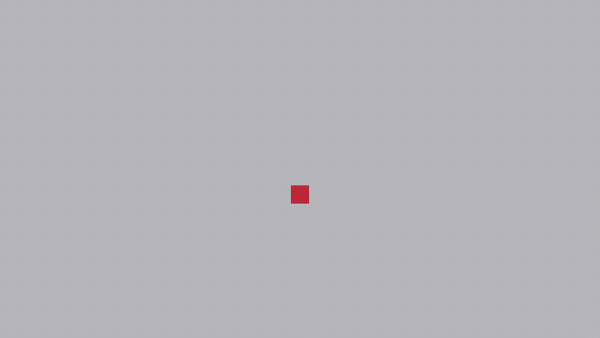
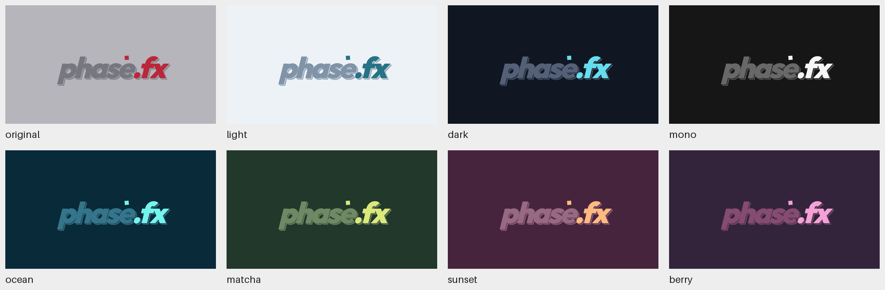

# Scattered tile wordmark

A small red block sets a low gray tile surface rippling. The tiles rise into the air and give way to a heavy extruded wordmark before the camera moves past it.

| | |
| --- | --- |
| **Category** | [3D › 3D text](../) |
| **Size** | 464 × 261 CSS pixels, exported at 2× |
| **Colorways** | original, light, dark, mono, ocean, matcha, sunset, berry |
| **Fonts** | Outfit, bundled under the SIL Open Font License |
| **Artwork** | Original projected tile field, kinetic block and neutral three-dimensional lettering. |
| **Animated** | Yes, 11.75-second loop at 24 fps |
| **Based on** | [A TikTok by @paulcodes4](https://www.tiktok.com/@paulcodes4/video/7694555188107021588) |

## Every colorway

## Files

- [Open the standalone design](source/design.html). Select the scene to replay the loop.
- Add `#ocean` to switch palettes or `?t=8.5#ocean` to freeze the animation.
- [Exports](exports/) holds the colorway PNGs and H.264 loops.

## Changing it

Edit the palette variables at the top of [the source](source/design.html), then run `python3 .github/scripts/export_design.py 3d/3d-text/scattered-tile-wordmark` from the repository root.
