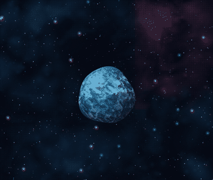
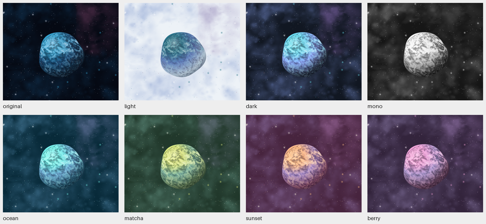

# Nebula glass planetoid

A finely speckled, irregular blue planetoid turns against a deep star field. It grows in the frame, catches a warm glint and recedes inside a transparent spherical envelope.

| | |
| --- | --- |
| **Category** | [3D › Abstract](../) |
| **Size** | 576 × 486 CSS pixels, exported at 2× |
| **Colorways** | original, light, dark, mono, ocean, matcha, sunset, berry |
| **Fonts** | System sans serif |
| **Artwork** | Original procedural star field and mottled spherical surface with mathematical displacement. |
| **Animated** | Yes, 10.25-second loop at 24 fps |
| **Based on** | [A TikTok by @paulcodes4](https://www.tiktok.com/@paulcodes4/video/7691329382039751956) |

## Every colorway

## Files

- [Open the standalone design](source/design.html). Drag to turn the planetoid or double-click to replay the scale and light changes.
- Add `#ocean` to switch palettes or `?t=2.5#ocean` to freeze the animation.
- [Exports](exports/) holds the colorway PNGs and H.264 loops.

## Changing it

Edit the palette variables at the top of [the source](source/design.html), then run `python3 .github/scripts/export_design.py 3d/abstract/nebula-glass-planetoid` from the repository root.
