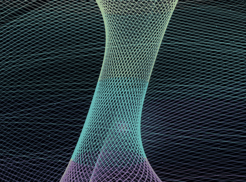
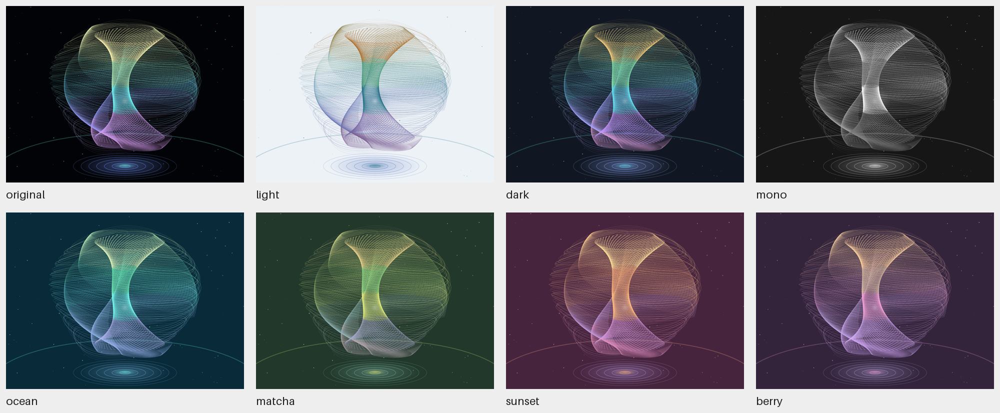

# Prismatic filament projector

A rotating volume of extremely fine pastel filaments hovers over a blue projector. A close view of the twisted strands pulls back into a globe and rolls towards its pole.

| | |
| --- | --- |
| **Category** | [3D › Abstract](../) |
| **Size** | 552 × 409 CSS pixels, exported at 2× |
| **Colorways** | original, light, dark, mono, ocean, matcha, sunset, berry |
| **Fonts** | System sans serif |
| **Artwork** | Original parametric filaments, projection rings and star particles. |
| **Animated** | Yes, 10.75-second loop at 24 fps |
| **Based on** | [A TikTok by @paulcodes4](https://www.tiktok.com/@paulcodes4/video/7690926798493732116) |

## Every colorway

## Files

- [Open the standalone design](source/design.html). Drag across the sphere to change its view, or double-click to replay the camera move.
- Add `#ocean` to switch palettes or `?t=3.0#ocean` to freeze the animation.
- [Exports](exports/) holds the colorway PNGs and H.264 loops.

## Changing it

Edit the palette variables at the top of [the source](source/design.html), then run `python3 .github/scripts/export_design.py 3d/abstract/prismatic-filament-projector` from the repository root.
