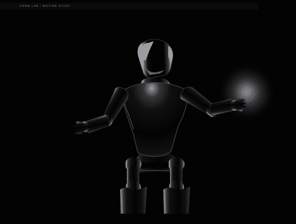
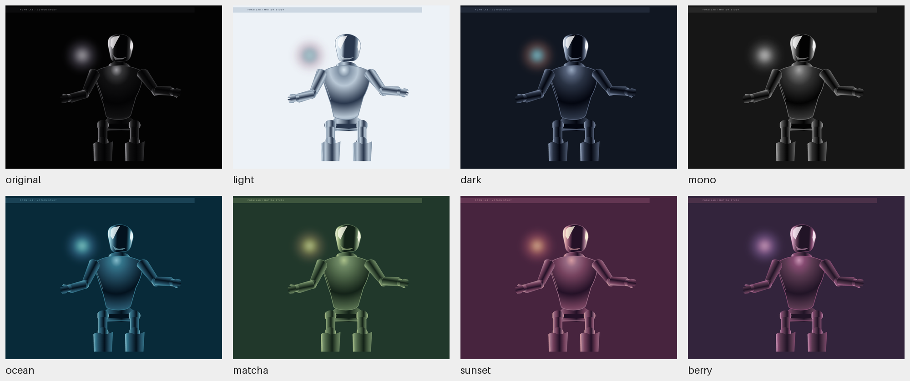

# Obsidian light follower

A glossy black robot follows a moving pool of light. Highlights trace its segmented face, shoulders and forearms as the elbows change angle above a cropped mechanical hip assembly.

| | |
| --- | --- |
| **Category** | [3D › Characters](../) |
| **Size** | 576 × 435 CSS pixels, exported at 2× |
| **Colorways** | original, light, dark, mono, ocean, matcha, sunset, berry |
| **Fonts** | System sans serif |
| **Artwork** | Original vector character with articulated limb pivots, bevels and reflective surfaces. |
| **Animated** | Yes, 16.25-second loop at 24 fps |
| **Based on** | [A TikTok by @paulcodes4](https://www.tiktok.com/@paulcodes4/video/7697531987120114996) |

## Every colorway

## Files

- [Open the standalone design](source/design.html). Drag the light across the stage to move the head and arms, or double-click to replay the choreography.
- Add `#ocean` to switch palettes or `?t=1#ocean` to freeze the animation.
- [Exports](exports/) holds the colorway PNGs and H.264 loops.

## Changing it

Edit the palette variables at the top of [the source](source/design.html), then run `python3 .github/scripts/export_design.py 3d/characters/obsidian-light-follower` from the repository root.
