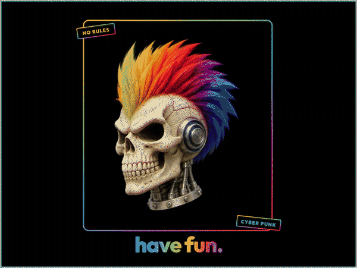
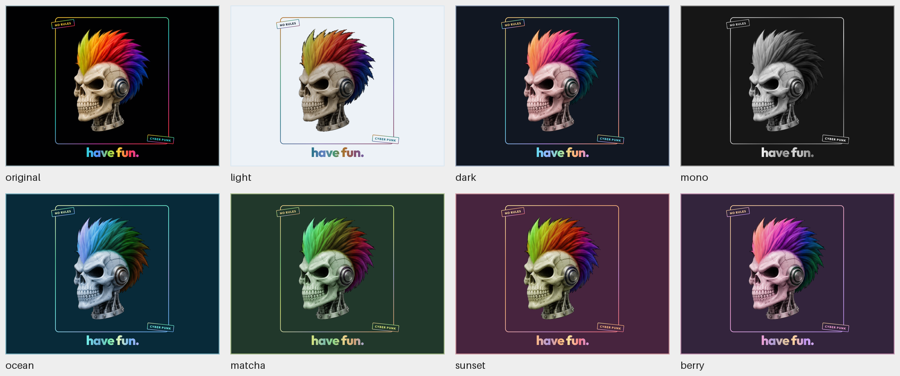

# Spectrum mohawk sculpture

A ceramic cyberpunk skull rotates inside a fine rainbow frame. The sequence shows its bright mohawk, concentric ear pieces, mechanical neck and the underside and crown of the sculpture.

| | |
| --- | --- |
| **Category** | [3D › Characters](../) |
| **Size** | 475 × 357 CSS pixels, exported at 2× |
| **Colorways** | original, light, dark, mono, ocean, matcha, sunset, berry |
| **Fonts** | Outfit, bundled under the SIL Open Font License |
| **Artwork** | Six original generated studio views of an unbranded sculpture, plus original SVG labels and frame. |
| **Animated** | Yes, 11.25-second loop at 24 fps |
| **Based on** | [A TikTok by @paulcodes4](https://www.tiktok.com/@paulcodes4/video/7696786102044216596) |

## Every colorway

## Files

- [Open the standalone design](source/design.html). Drag across the sculpture to scrub its views, or double-click to replay.
- Add `#ocean` to switch palettes or `?t=1.05#ocean` to freeze the animation.
- [Exports](exports/) holds the colorway PNGs and H.264 loops.

## Changing it

Edit the palette variables at the top of [the source](source/design.html), then run `python3 .github/scripts/export_design.py 3d/characters/spectrum-mohawk-sculpture` from the repository root.
