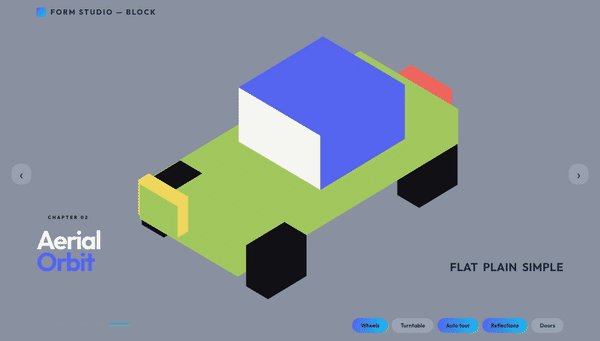
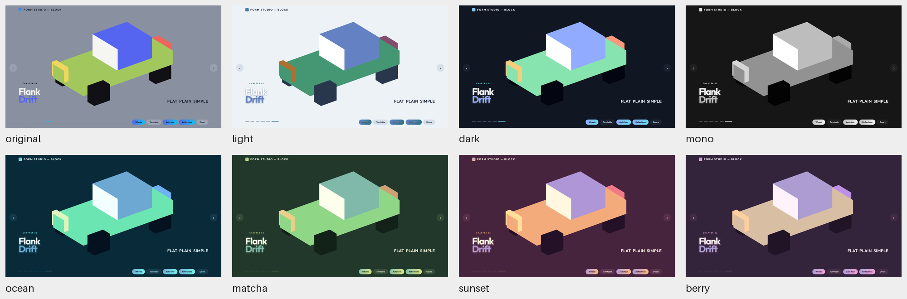

# Block axle turntable

A deliberately simple model viewer rotates a toy-like vehicle made of flat green, blue, yellow and red blocks with four black wheels.

| | |
| --- | --- |
| **Category** | [3D › Low-poly](../) |
| **Size** | 576 × 327 CSS pixels, exported at 2× |
| **Colorways** | original, light, dark, mono, ocean, matcha, sunset, berry |
| **Fonts** | Outfit, bundled under the SIL Open Font License |
| **Artwork** | Original projected cuboid geometry for the vehicle and original viewer controls. |
| **Animated** | Yes, 2.5-second loop at 24 fps |
| **Based on** | [A TikTok by @paulcodes4](https://www.tiktok.com/@paulcodes4/video/7697684391560023317) |

## Every colorway

## Files

- [Open the standalone design](source/design.html). Use the side arrows to change the camera angle and Auto tour to pause the rotation.
- Add `#ocean` to switch palettes or `?t=0.5#ocean` to freeze the animation.
- [Exports](exports/) holds the colorway PNGs and H.264 loops.

The same comparison post also shows [Ruby wing coupe](../../../3d/product-renders/ruby-wing-coupe/).

## Changing it

Edit the palette variables at the top of [the source](source/design.html), then run `python3 .github/scripts/export_design.py 3d/low-poly/block-axle-turntable` from the repository root.
