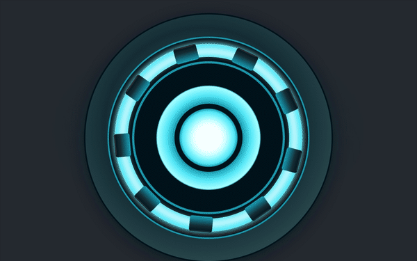
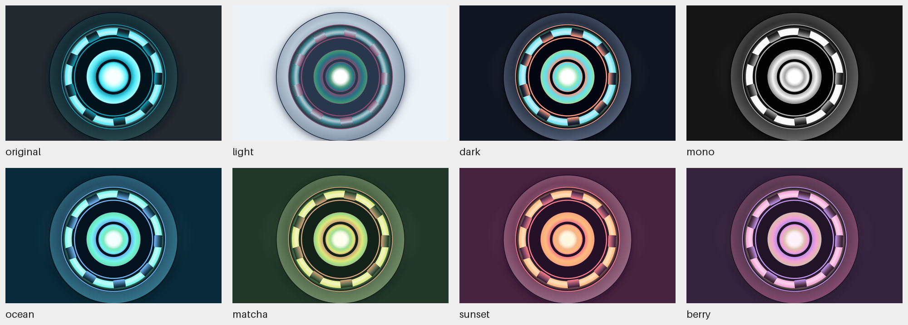

# Aqua concentric core

A cyan light pulses inside a circular metal housing. The dark rectangular inserts revolve around a glowing annulus while the inner lamp stays centered.

| | |
| --- | --- |
| **Category** | [3D › Product renders](../) |
| **Size** | 576 × 360 CSS pixels, exported at 2× |
| **Colorways** | original, light, dark, mono, ocean, matcha, sunset, berry |
| **Fonts** | System sans serif |
| **Artwork** | Original concentric housing, beveled inserts and emissive gradients. |
| **Animated** | Yes, 8.75-second loop at 24 fps |
| **Based on** | [A TikTok by @paulcodes4](https://www.tiktok.com/@paulcodes4/video/7693617992516570389) |

## Every colorway

## Files

- [Open the standalone design](source/design.html). Select the scene to replay the loop.
- Add `#ocean` to switch palettes or `?t=2#ocean` to freeze the animation.
- [Exports](exports/) holds the colorway PNGs and H.264 loops.

## Changing it

Edit the palette variables at the top of [the source](source/design.html), then run `python3 .github/scripts/export_design.py 3d/product-renders/aqua-concentric-core` from the repository root.
