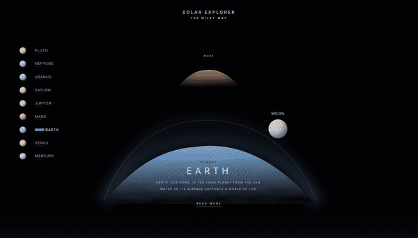
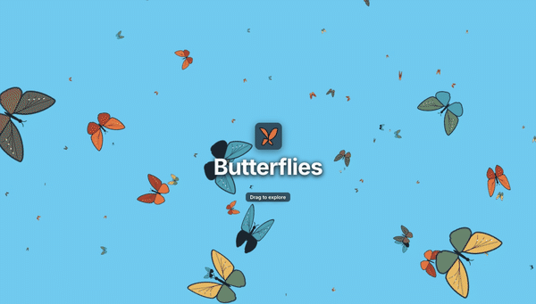

<!-- Generated by .github/scripts/build_catalog.py. Edit that file, not this one. -->
# Scenes

Full 3D scenes.

Part of [3D](../).

## Designs (2)

<table>
<tr><td align="center" valign="top" width="33%"> <a href="orbital-horizon-explorer/"><b>Orbital horizon explorer</b></a> 8 colorways</td><td align="center" valign="top" width="33%"> <a href="sky-blue-butterfly-flight/"><b>Sky-blue butterfly flight</b></a> 8 colorways</td></tr>
</table>

Adding one? See [Adding a design](../../README.md#adding-a-design).
