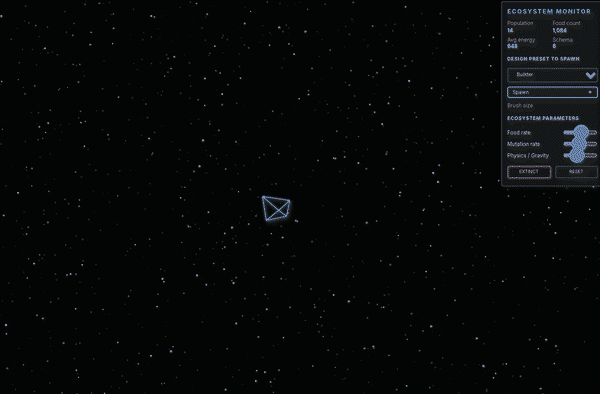
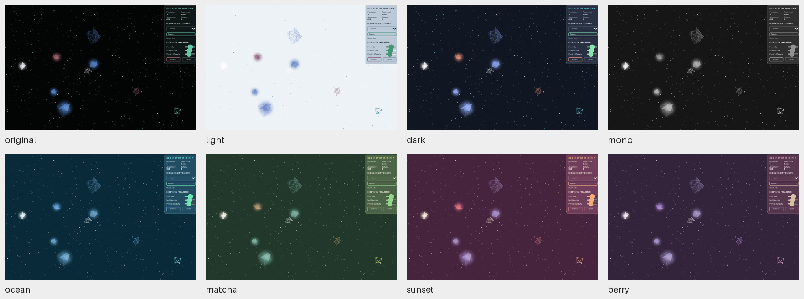

# Constellation creature ecosystem

A single pale wireframe organism drifts through a star field. The ecosystem gradually fills with moving translucent creatures, bright blue clusters, trailing geometric shells and an on-screen control panel.

| | |
| --- | --- |
| **Category** | [3D › Scenes](../) |
| **Size** | 576 × 378 CSS pixels, exported at 2× |
| **Colorways** | original, light, dark, mono, ocean, matcha, sunset, berry |
| **Fonts** | Inter, bundled under the SIL Open Font License |
| **Artwork** | Original procedural polyhedral organisms, trajectories, translucent facets and star field. |
| **Animated** | Yes, 13.5-second loop at 24 fps |
| **Based on** | [A TikTok by @paulcodes4](https://www.tiktok.com/@paulcodes4/video/7691587226534268180) |

## Every colorway

## Files

- [Open the standalone design](source/design.html). Choose a species and select Spawn. Use the parameter sliders, Extinct or Reset to change the scene.
- Add `#ocean` to switch palettes or `?t=8.5#ocean` to freeze the animation.
- [Exports](exports/) holds the colorway PNGs and H.264 loops.

## Changing it

Edit the palette variables at the top of [the source](source/design.html), then run `python3 .github/scripts/export_design.py 3d/scenes/constellation-creature-ecosystem` from the repository root.
