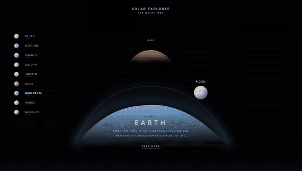
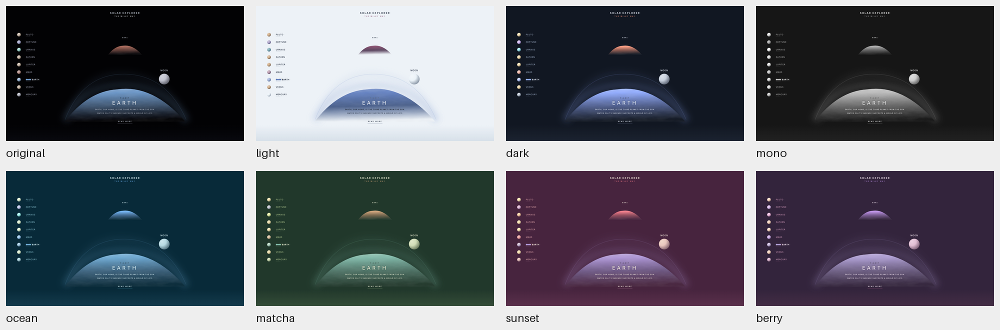

# Orbital horizon explorer

A compact planetary index sits beside a stack of atmospheric horizons. The camera travels from Earth to Neptune and Jupiter, revealing moon labels and a short description for each selected world.

| | |
| --- | --- |
| **Category** | [3D › Scenes](../) |
| **Size** | 576 × 327 CSS pixels, exported at 2× |
| **Colorways** | original, light, dark, mono, ocean, matcha, sunset, berry |
| **Fonts** | Inter, bundled under the SIL Open Font License |
| **Artwork** | Original planetary gradients, orbit diagrams, atmospheric textures and navigation. |
| **Animated** | Yes, 13.25-second loop at 24 fps |
| **Based on** | [A TikTok by @paulcodes4](https://www.tiktok.com/@paulcodes4/video/7691591371895115029) |

## Every colorway

## Files

- [Open the standalone design](source/design.html). Choose any of the nine worlds in the left index to hold its information view.
- Add `#ocean` to switch palettes or `?t=1.0#ocean` to freeze the animation.
- [Exports](exports/) holds the colorway PNGs and H.264 loops.

## Changing it

Edit the palette variables at the top of [the source](source/design.html), then run `python3 .github/scripts/export_design.py 3d/scenes/orbital-horizon-explorer` from the repository root.
