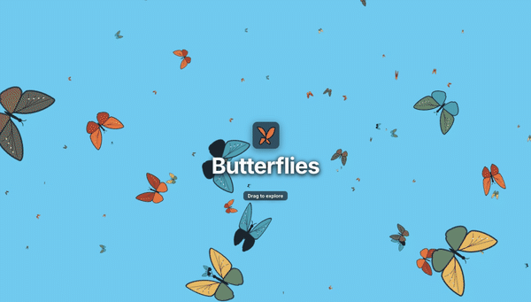
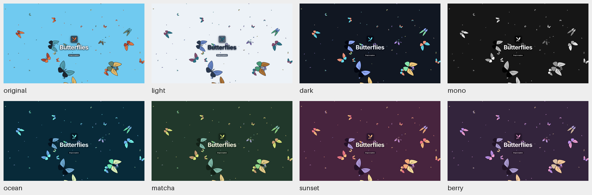

# Sky-blue butterfly flight

Dozens of butterflies move at different depths through a clear blue field. Their silhouettes open and fold around a small central butterfly mark and title.

| | |
| --- | --- |
| **Category** | [3D › Scenes](../) |
| **Size** | 576 × 327 CSS pixels, exported at 2× |
| **Colorways** | original, light, dark, mono, ocean, matcha, sunset, berry |
| **Fonts** | Inter, bundled under the SIL Open Font License |
| **Artwork** | Original procedural wings with curved membranes, vein marks, spotting, flapping and depth projection. |
| **Animated** | Yes, 9.75-second loop at 24 fps |
| **Based on** | [A TikTok by @paulcodes4](https://www.tiktok.com/@paulcodes4/video/7701019256653221140) |

## Every colorway

## Files

- [Open the standalone design](source/design.html). Drag across the field to change the view through the butterflies.
- Add `#ocean` to switch palettes or `?t=2.53#ocean` to freeze the animation.
- [Exports](exports/) holds the colorway PNGs and H.264 loops.

## Changing it

Edit the palette variables at the top of [the source](source/design.html), then run `python3 .github/scripts/export_design.py 3d/scenes/sky-blue-butterfly-flight` from the repository root.
