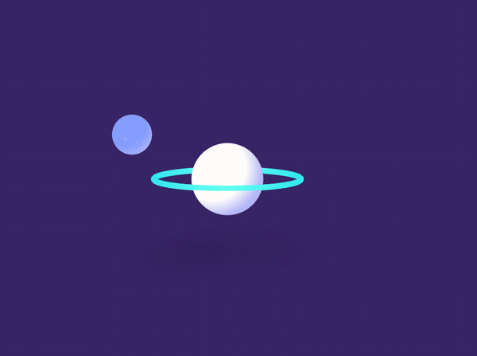
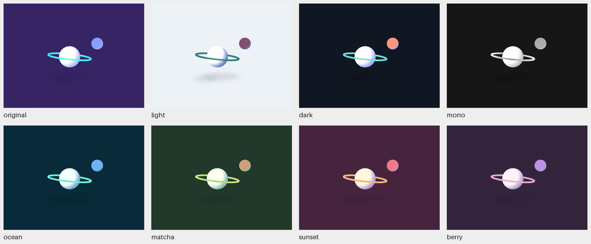

# Hula ring Saturn

A pale planet floats above a violet field as a turquoise ring tilts around its equator. A small cratered moon passes behind the planet in a wider orbit.

| | |
| --- | --- |
| **Category** | [Animations › 3D animation](../) |
| **Size** | 430 × 320 CSS pixels, exported at 2× |
| **Colorways** | original, light, dark, mono, ocean, matcha, sunset, berry |
| **Fonts** | System sans serif |
| **Artwork** | Original vector spheres, ring and ground shadows. |
| **Animated** | Yes, 5.25-second loop at 24 fps |
| **Based on** | [A TikTok by @paulcodes4](https://www.tiktok.com/@paulcodes4/video/7696787198535912725) |

## Every colorway

## Files

- [Open the standalone design](source/design.html). Select the scene to replay the loop.
- Add `#ocean` to switch palettes or `?t=1.5#ocean` to freeze the animation.
- [Exports](exports/) holds the colorway PNGs and H.264 loops.

## Changing it

Edit the palette variables at the top of [the source](source/design.html), then run `python3 .github/scripts/export_design.py animations/3d-animation/hula-ring-saturn` from the repository root.
