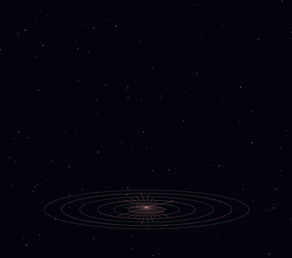
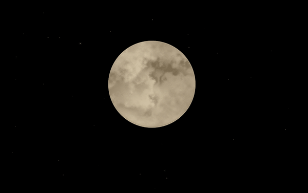
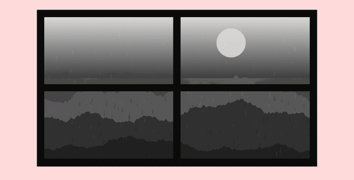

<!-- Generated by .github/scripts/build_catalog.py. Edit that file, not this one. -->
# Animated illustrations

Animated illustrations.

Part of [Animations](../).

## Designs (18)

<table>
<tr><td align="center" valign="top" width="33%"> <a href="amethyst-branch-canopy/"><b>Amethyst branch canopy</b></a> 8 colorways</td><td align="center" valign="top" width="33%"> <a href="aurora-orchard/"><b>Aurora orchard</b></a> 8 colorways</td><td align="center" valign="top" width="33%"> <a href="cobalt-fan-peacock/"><b>Cobalt fan peacock</b></a> 8 colorways</td></tr>
<tr><td align="center" valign="top" width="33%"> <a href="dusk-street-lantern/"><b>Dusk street lantern</b></a> 8 colorways</td><td align="center" valign="top" width="33%"> <a href="fox-in-falling-snow/"><b>Fox in falling snow</b></a> 8 colorways</td><td align="center" valign="top" width="33%"> <a href="gold-thread-fir/"><b>Gold thread fir</b></a> 8 colorways</td></tr>
<tr><td align="center" valign="top" width="33%"> <a href="ink-and-cherry-canopy/"><b>Ink and cherry canopy</b></a> 8 colorways</td><td align="center" valign="top" width="33%"> <a href="little-mars-flag/"><b>Little Mars flag</b></a> 8 colorways</td><td align="center" valign="top" width="33%"> <a href="navratri-garba-circle/"><b>Navratri garba circle</b></a> 8 colorways</td></tr>
<tr><td align="center" valign="top" width="33%"> <a href="ochre-crater-moon/"><b>Ochre crater moon</b></a> 8 colorways</td><td align="center" valign="top" width="33%"> <a href="rain-on-the-four-panes/"><b>Rain on the four panes</b></a> 8 colorways</td><td align="center" valign="top" width="33%"> <a href="ribbon-rose-bloom/"><b>Ribbon rose bloom</b></a> 8 colorways</td></tr>
<tr><td align="center" valign="top" width="33%"> <a href="scarlet-broken-heart/"><b>Scarlet broken heart</b></a> 8 colorways</td><td align="center" valign="top" width="33%"> <a href="silk-orb-weaver/"><b>Silk orb weaver</b></a> 8 colorways</td><td align="center" valign="top" width="33%"> <a href="spectrum-blooming-tree/"><b>Spectrum blooming tree</b></a> 8 colorways</td></tr>
<tr><td align="center" valign="top" width="33%"> <a href="spectrum-guardian-mask/"><b>Spectrum guardian mask</b></a> 8 colorways</td><td align="center" valign="top" width="33%"> <a href="whispered-heart-portrait/"><b>Whispered heart portrait</b></a> 8 colorways</td><td align="center" valign="top" width="33%"> <a href="winter-bauble-etching/"><b>Winter bauble etching</b></a> 8 colorways</td></tr>
</table>

Adding one? See [Adding a design](../../README.md#adding-a-design).
