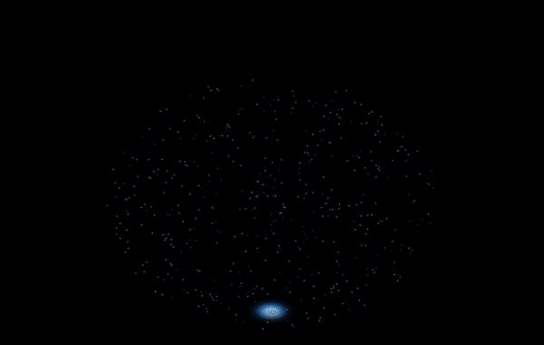
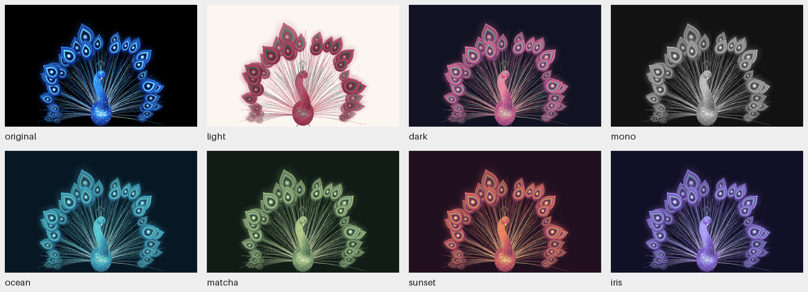

# Cobalt fan peacock

A luminous blue peacock rises from a cloud of sparks. Fine tapered shafts spread behind its curved neck and build a layered fan of cobalt eyes.

| | |
| --- | --- |
| **Category** | [Animations › Animated illustrations](../) |
| **Size** | 576 × 365 |
| **Colorways** | original, light, dark, mono, ocean, matcha, sunset, iris |
| **Fonts** | No visible text |
| **Icons** | Original procedural SVG geometry |
| **Animated** | 8.5 seconds, 24 fps |
| **Based on** | [A TikTok by @paulcodes4](https://www.tiktok.com/@paulcodes4/video/7699752020953140501) |

## Every colorway

## Files

- Open [the editable drawing](source/design.html) to watch the loop. Append a colorway such as `#ocean` or use `?t=7.3#original` to pause it.
- The [exports](exports/) include a full-size still and H.264 loop in every colorway.

## Changing it

The rounded body appears first. The neck and crest follow, then fine shafts radiate from the tail base. Nested teardrop eyes emerge at the crown and spread down the sides. Each color token lives in the palette blocks at the top of the HTML. Run `python3 .github/scripts/export_design.py animations/animated-illustrations/cobalt-fan-peacock` to refresh the media.
