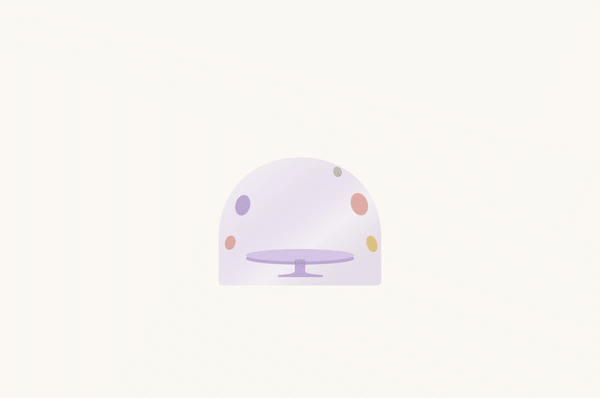
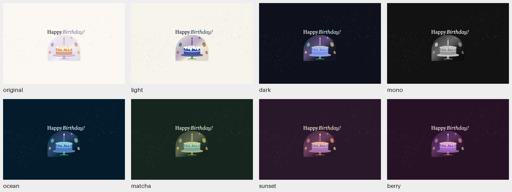

# Confetti cake dome

A candlelit cake appears on a lilac pedestal under a pastel dome as fine confetti sweeps around the birthday greeting.

| | |
| --- | --- |
| **Category** | [Animations › Animated illustrations](../) |
| **Size** | 576 × 382 CSS pixels, 2× export |
| **Colorways** | original, light, dark, mono, ocean, matcha, sunset, berry |
| **Fonts** | Georgia and Georgia Italic or the local serif fallback. |
| **Artwork** | Original procedural illustration and SVG geometry, drawn for Motherlode |
| **Animated** | Yes, 5.8-second loop |
| **Based on** | [A TikTok by @paulcodes4](https://www.tiktok.com/@paulcodes4/video/7694179091796233478) |

## Every colorway

## Files

- `source/design.html` is the standalone artwork. Its address accepts a palette such as `#matcha` and a preview time such as `?t=4.1#ocean`.
- `exports/` contains each palette’s PNG still and H.264 loop.

## Changing it

Cake, icing drips, striped candle, plate and confetti are independent SVG shapes. The candle flame flickers on its own short cycle. The colorway blocks at the top of the source define the inks and ground. Run `python3 .github/scripts/export_design.py animations/animated-illustrations/confetti-cake-dome` to regenerate the exports.
