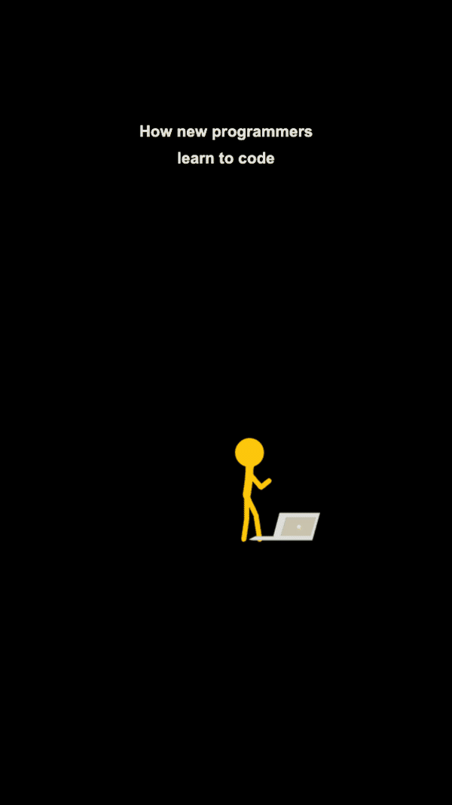
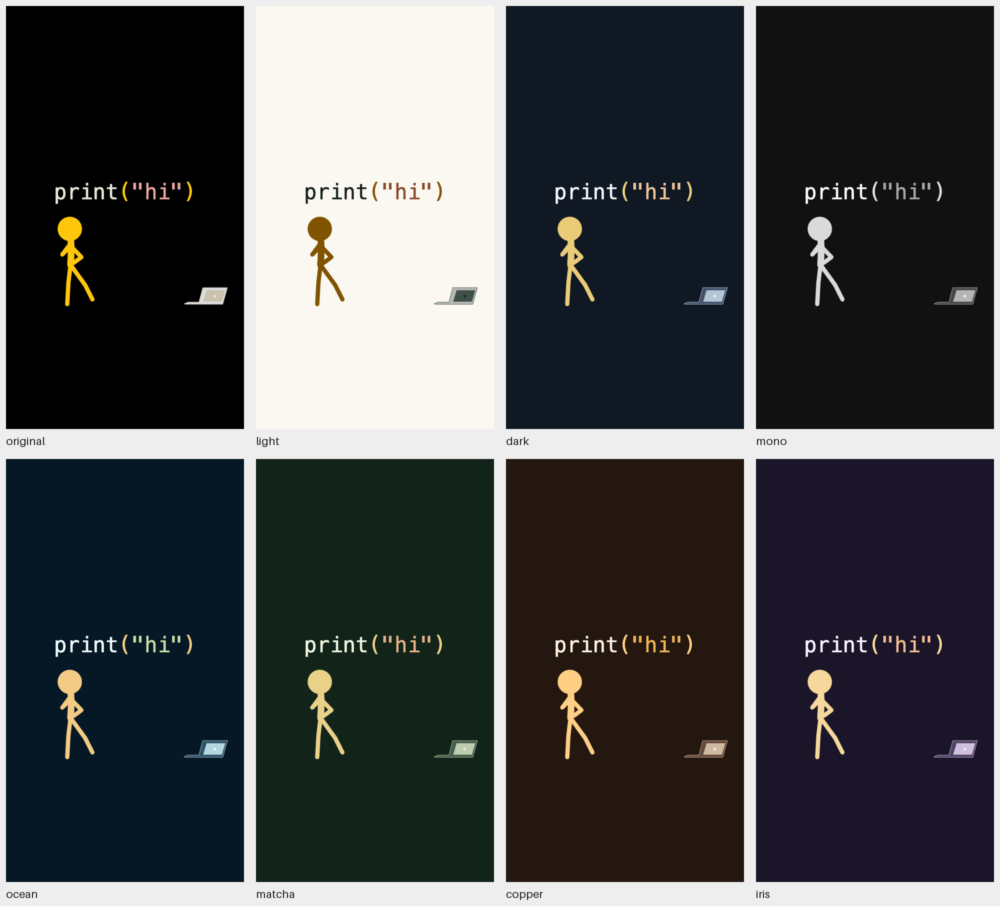

# First lines of code

A yellow stick figure gathers up a laptop and experiments with a few lines of code on a black stage. The text types on in small steps.

| | |
| --- | --- |
| **Category** | [Animations › Animated Illustrations](../) |
| **Size** | 576 × 1024 |
| **Colorways** | original, light, dark, mono, ocean, matcha, copper, iris |
| **Fonts** | Arial and Menlo, with system fallbacks. |
| **Artwork** | An original articulated figure, laptop, poses and code vignettes. |
| **Animated** | 61-second loop, 24 fps |
| **Based on** | [A TikTok by @paulcodes4](https://www.tiktok.com/@paulcodes4/video/7698715985607478549) |

## Every colorway

## Files

Open [the design](source/design.html) and add `#ocean` to its address to change the colorway. The [exports](exports/) contain a PNG for every palette, plus a matching MP4.

## Changing it

The CSS variables at the top of the source define the colors. Run `python3 .github/scripts/export_design.py animations/animated-illustrations/first-lines-of-code` to regenerate the media.
