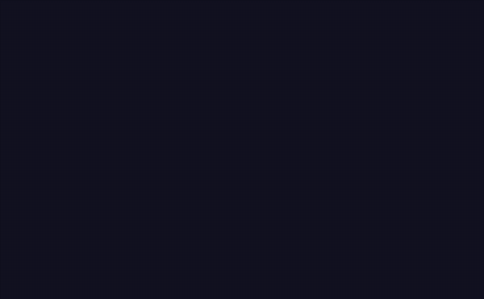
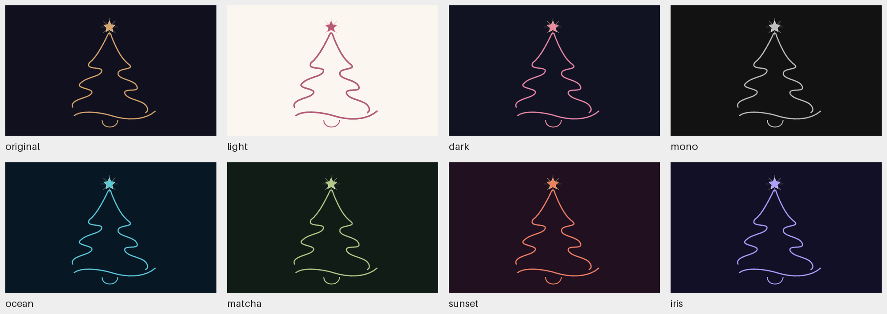

# Gold thread fir

A warm gold line draws a star-topped fir with delicately scalloped edges and a sweeping baseline on dark indigo.

| | |
| --- | --- |
| **Category** | [Animations › Animated illustrations](../) |
| **Size** | 576 × 356 |
| **Colorways** | original, light, dark, mono, ocean, matcha, sunset, iris |
| **Fonts** | No visible text |
| **Icons** | Original procedural SVG geometry |
| **Animated** | 8.5 seconds, 24 fps |
| **Based on** | [A TikTok by @paulcodes4](https://www.tiktok.com/@paulcodes4/video/7698713736210681108) |

## Every colorway

## Files

- Open [the editable drawing](source/design.html) to watch the loop. Append a colorway such as `#ocean` or use `?t=7.6#original` to pause it.
- The [exports](exports/) include a full-size still and H.264 loop in every colorway.

## Changing it

The lower flourish, tree outline, trunk and star retain independent editable paths. Each color token lives in the palette blocks at the top of the HTML. Run `python3 .github/scripts/export_design.py animations/animated-illustrations/gold-thread-fir` to refresh the media.
