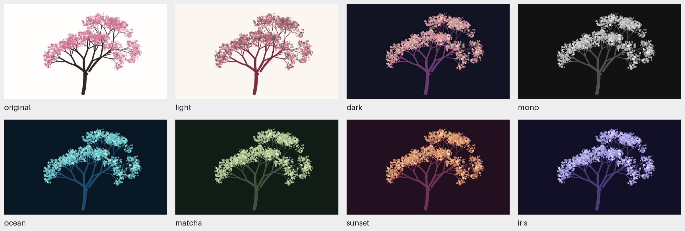

# Ink and cherry canopy

An ink trunk splits into crooked, tapered branches against white. A cluster of small rose blossoms spreads through the canopy.

| | |
| --- | --- |
| **Category** | [Animations › Animated illustrations](../) |
| **Size** | 576 × 336 |
| **Colorways** | original, light, dark, mono, ocean, matcha, sunset, iris |
| **Fonts** | No visible text |
| **Icons** | Original procedural SVG geometry |
| **Animated** | 7.5 seconds, 24 fps |
| **Based on** | [A TikTok by @paulcodes4](https://www.tiktok.com/@paulcodes4/video/7697522884209642773) |

## Every colorway

## Files

- Open [the editable drawing](source/design.html) to watch the loop. Append a colorway such as `#ocean` or use `?t=6.95#original` to pause it.
- The [exports](exports/) include a full-size still and H.264 loop in every colorway.

## Changing it

The branches extend before the blossoms appear. A deterministic seed keeps their individual shapes and placement editable. Each color token lives in the palette blocks at the top of the HTML. Run `python3 .github/scripts/export_design.py animations/animated-illustrations/ink-and-cherry-canopy` to refresh the media.
