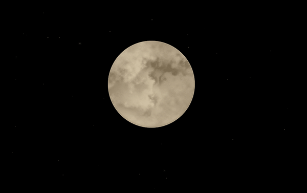
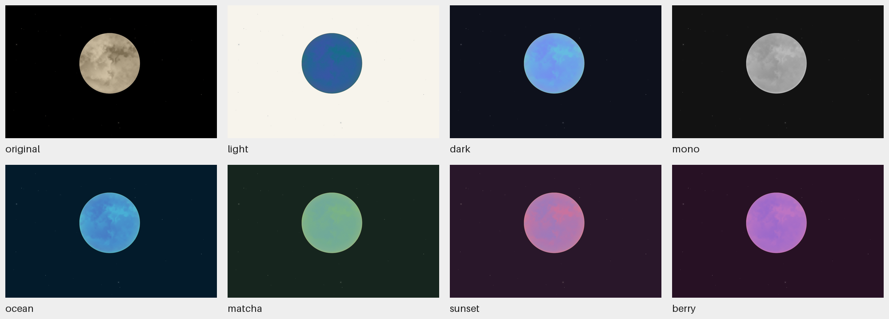

# Ochre crater moon

A warm cratered moon hangs in black space while a handful of distant stars glint and fade.

| | |
| --- | --- |
| **Category** | [Animations › Animated illustrations](../) |
| **Size** | 576 × 362 CSS pixels, 2× export |
| **Colorways** | original, light, dark, mono, ocean, matcha, sunset, berry |
| **Fonts** | None. The artwork contains no lettering. |
| **Artwork** | Original procedural illustration and SVG geometry, drawn for Motherlode |
| **Animated** | Yes, 6.4-second loop |
| **Based on** | [A TikTok by @paulcodes4](https://www.tiktok.com/@paulcodes4/video/7694360898844052737) |

## Every colorway

## Files

- `source/design.html` is the standalone artwork. Its address accepts a palette such as `#matcha` and a preview time such as `?t=2.8#ocean`.
- `exports/` contains each palette’s PNG still and H.264 loop.

## Changing it

The lunar surface uses a seeded, independently generated terrain mask. Multiple-scale noise, elliptical lava plains and shallow crater rims modulate the palette’s two surface inks. The colorway blocks at the top of the source define the inks and ground. Run `python3 .github/scripts/export_design.py animations/animated-illustrations/ochre-crater-moon` to regenerate the exports.
