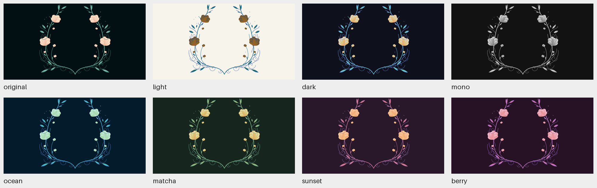

# Peach bloom wreath

Mirrored sprigs of peach flowers, turquoise leaves and curled tendrils grow into an open wreath against deep green-black.

| | |
| --- | --- |
| **Category** | [Animations › Animated illustrations](../) |
| **Size** | 576 × 309 CSS pixels, 2× export |
| **Colorways** | original, light, dark, mono, ocean, matcha, sunset, berry |
| **Fonts** | None. The artwork contains no lettering. |
| **Artwork** | Original procedural illustration and SVG geometry, drawn for Motherlode |
| **Animated** | Yes, 5.8-second loop |
| **Based on** | [A TikTok by @paulcodes4](https://www.tiktok.com/@paulcodes4/video/7693450857320434964) |

## Every colorway

## Files

- `source/design.html` is the standalone artwork. Its address accepts a palette such as `#matcha` and a preview time such as `?t=4.8#ocean`.
- `exports/` contains each palette’s PNG still and H.264 loop.

## Changing it

Each branch uses drawn stems, veined leaves, curled offshoots and individually shaped flower petals. The second branch reflects the first around the centerline. The colorway blocks at the top of the source define the inks and ground. Run `python3 .github/scripts/export_design.py animations/animated-illustrations/peach-bloom-wreath` to regenerate the exports.
