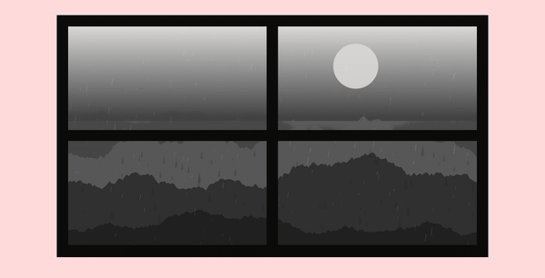
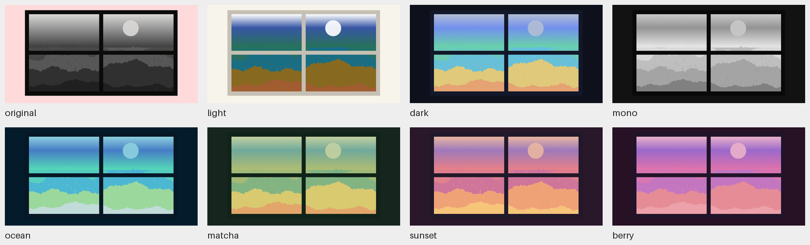

# Rain on the four panes

Raindrops slide over a four-pane black window facing a misty moon and a layered mountain ridge.

| | |
| --- | --- |
| **Category** | [Animations › Animated illustrations](../) |
| **Size** | 576 × 294 CSS pixels, 2× export |
| **Colorways** | original, light, dark, mono, ocean, matcha, sunset, berry |
| **Fonts** | None. The artwork contains no lettering. |
| **Artwork** | Original procedural illustration and SVG geometry, drawn for Motherlode |
| **Animated** | Yes, 5-second loop |
| **Based on** | [A TikTok by @paulcodes4](https://www.tiktok.com/@paulcodes4/video/7695085565925920020) |

## Every colorway

## Files

- `source/design.html` is the standalone artwork. Its address accepts a palette such as `#matcha` and a preview time such as `?t=2.6#ocean`.
- `exports/` contains each palette’s PNG still and H.264 loop.

## Changing it

The frame clips independently generated mountain silhouettes, four layers of rain and a pale moon. Change the ridge functions to redraw the landscape. The colorway blocks at the top of the source define the inks and ground. Run `python3 .github/scripts/export_design.py animations/animated-illustrations/rain-on-the-four-panes` to regenerate the exports.
