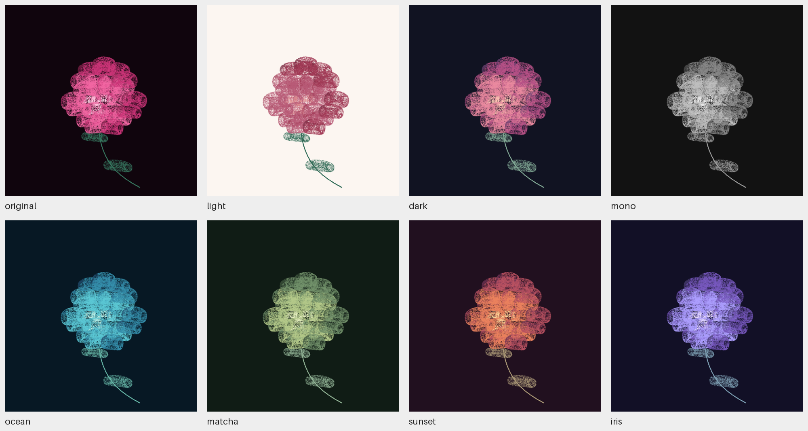

# Ribbon rose bloom

A curved green stem supports a rose made from overlapping loops of luminous pink wire.

| | |
| --- | --- |
| **Category** | [Animations › Animated illustrations](../) |
| **Size** | 466 × 463 |
| **Colorways** | original, light, dark, mono, ocean, matcha, sunset, iris |
| **Fonts** | No visible text |
| **Icons** | Original procedural SVG geometry |
| **Animated** | 10.5 seconds, 24 fps |
| **Based on** | [A TikTok by @paulcodes4](https://www.tiktok.com/@paulcodes4/video/7709027636906855701) |

## Every colorway

## Files

- Open [the editable drawing](source/design.html) to watch the loop. Append a colorway such as `#ocean` or use `?t=9.5#original` to pause it.
- The [exports](exports/) include a full-size still and H.264 loop in every colorway.

## Changing it

The stem and leaves grow first. Rings of petals build from a pale center toward the darker outer edge. Each color token lives in the palette blocks at the top of the HTML. Run `python3 .github/scripts/export_design.py animations/animated-illustrations/ribbon-rose-bloom` to refresh the media.
