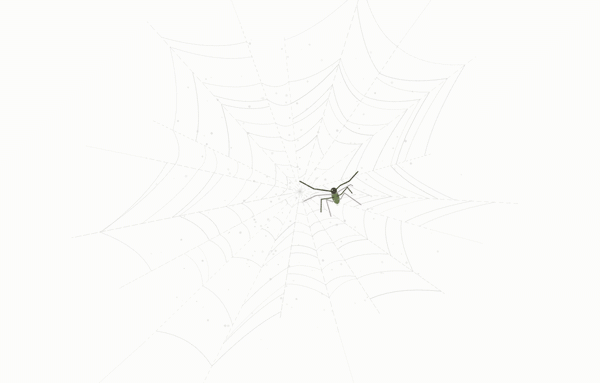
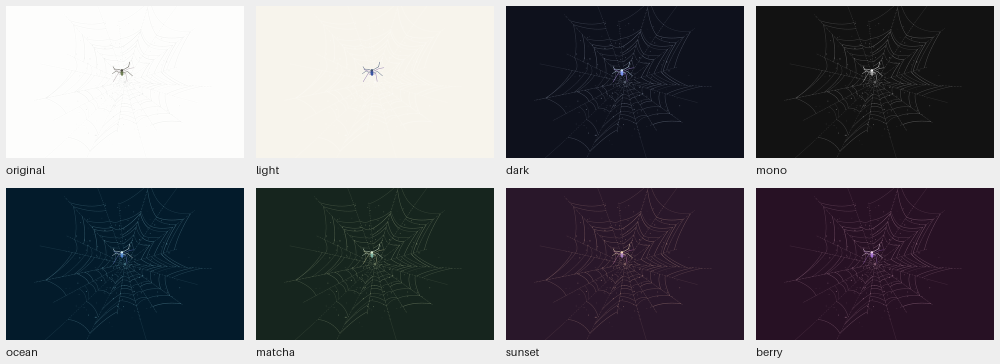

# Silk orb weaver

A small, fine-legged spider moves across an irregular radial web on a warm white field.

| | |
| --- | --- |
| **Category** | [Animations › Animated illustrations](../) |
| **Size** | 576 × 368 CSS pixels, 2× export |
| **Colorways** | original, light, dark, mono, ocean, matcha, sunset, berry |
| **Fonts** | None. The artwork contains no lettering. |
| **Artwork** | Original procedural illustration and SVG geometry, drawn for Motherlode |
| **Animated** | Yes, 5.6-second loop |
| **Based on** | [A TikTok by @paulcodes4](https://www.tiktok.com/@paulcodes4/video/7694180516819455253) |

## Every colorway

## Files

- `source/design.html` is the standalone artwork. Its address accepts a palette such as `#matcha` and a preview time such as `?t=2.1#ocean`.
- `exports/` contains each palette’s PNG still and H.264 loop.

## Changing it

The spider turns toward the pointer. Change the branching spokes, incomplete loops and leg phase offsets to adjust its web and gait. The colorway blocks at the top of the source define the inks and ground. Run `python3 .github/scripts/export_design.py animations/animated-illustrations/silk-orb-weaver` to regenerate the exports.
