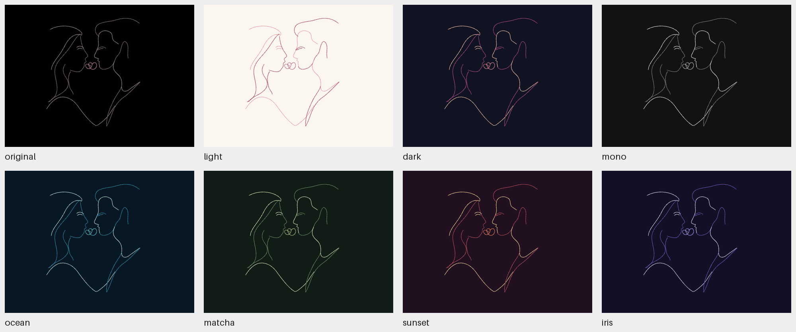

# Whispered heart portrait

Two original continuous-line profiles lean inward on black, meeting at a tiny heart between their lips.

| | |
| --- | --- |
| **Category** | [Animations › Animated illustrations](../) |
| **Size** | 493 × 370 |
| **Colorways** | original, light, dark, mono, ocean, matcha, sunset, iris |
| **Fonts** | No visible text |
| **Icons** | Original procedural SVG geometry |
| **Animated** | 7.8 seconds, 24 fps |
| **Based on** | [A TikTok by @paulcodes4](https://www.tiktok.com/@paulcodes4/video/7700145133550947585) |

## Every colorway

## Files

- Open [the editable drawing](source/design.html) to watch the loop. Append a colorway such as `#ocean` or use `?t=6.8#original` to pause it.
- The [exports](exports/) include a full-size still and H.264 loop in every colorway.

## Changing it

A fine pen follows the woman’s hair and face, the heart and the second profile. The closing strokes suggest shoulders and hands. Each color token lives in the palette blocks at the top of the HTML. Run `python3 .github/scripts/export_design.py animations/animated-illustrations/whispered-heart-portrait` to refresh the media.
