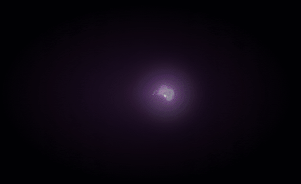
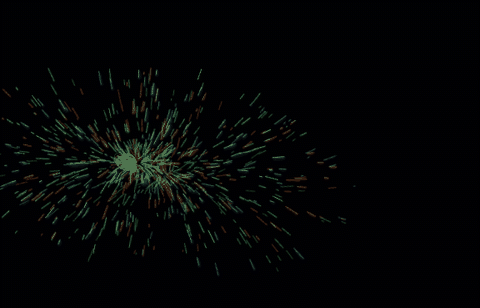
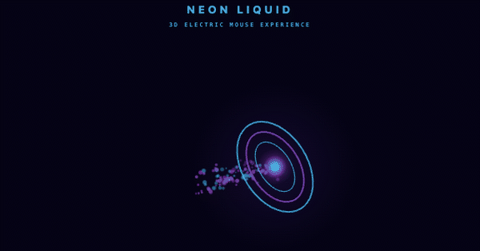
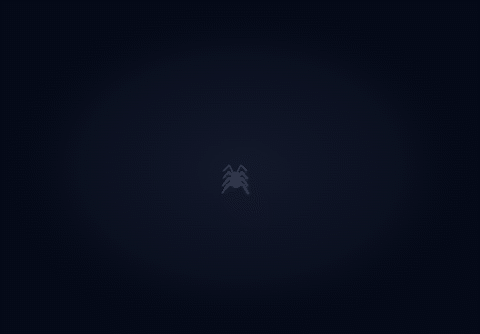

<!-- Generated by .github/scripts/build_catalog.py. Edit that file, not this one. -->
# Cursor effects

Cursor trails and effects.

Part of [Animations](../).

## Designs (5)

<table>
<tr><td align="center" valign="top" width="33%"> <a href="aurora-ribbon-cursor/"><b>Aurora ribbon cursor</b></a> 8 colorways</td><td align="center" valign="top" width="33%"> <a href="cyan-click-sign-in/"><b>Cyan click sign-in</b></a> 8 colorways</td><td align="center" valign="top" width="33%"> <a href="meteor-swarm-cursor/"><b>Meteor swarm cursor</b></a> 8 colorways</td></tr>
<tr><td align="center" valign="top" width="33%"> <a href="neon-liquid-trail/"><b>Neon liquid trail</b></a> 8 colorways</td><td align="center" valign="top" width="33%"> <a href="silk-trail-spider/"><b>Silk trail spider</b></a> 8 colorways</td></tr>
</table>

Adding one? See [Adding a design](../../README.md#adding-a-design).
