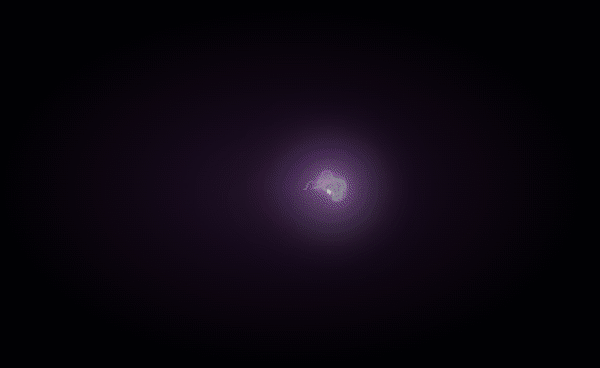
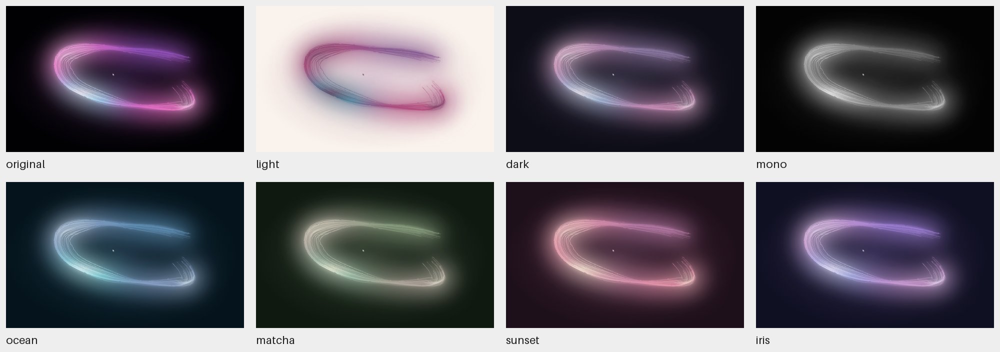

# Aurora ribbon cursor

Fine parallel threads turn into an aurora-colored ribbon as the pointer curls across a black field.

| | |
| --- | --- |
| **Category** | [Animations › Cursor effects](../) |
| **Size** | 576 × 353 |
| **Colorways** | original, light, dark, mono, ocean, matcha, sunset, iris |
| **Fonts** | No visible text |
| **Artwork** | Original SVG filament geometry, spatial color gradients and glow masks |
| **Animated** | 8 seconds, 24 fps |
| **Based on** | [A TikTok by @paulcodes4](https://www.tiktok.com/@paulcodes4/video/7701977616949267733) |

## Every colorway

## Files

- Open [the editable drawing](source/design.html) to watch the loop. Append a colorway such as `#ocean` or use `?t=4#original` to pause it.
- The [exports](exports/) include a full-size still and H.264 loop in every colorway.

## Changing it

Seventeen translucent filaments share a curved centerline. Small delays, different widths and a blurred outer trail make the ribbon twist as the pointer turns. Move the pointer to draw your own trail and leave the field to resume the animated preview. Each color token lives in the palette blocks at the top of the HTML. Run `python3 .github/scripts/export_design.py animations/cursor-effects/aurora-ribbon-cursor` to refresh the media.
