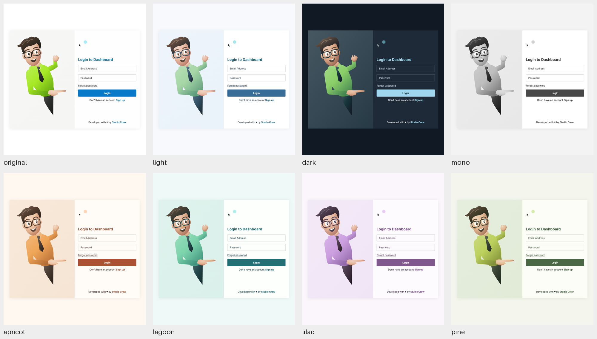

# Cyan click sign-in

A tiny cyan light expands and fades wherever the pointer lands on a split sign-in screen. An original chartreuse studio helper points toward the form.

| | |
| --- | --- |
| **Category** | [Animations › Cursor effects](../) |
| **Size** | 816 × 870 CSS pixels, exported at 2× |
| **Colorways** | original, light, dark, mono, apricot, lagoon, lilac, pine |
| **Fonts** | Inter (bundled Latin subset from Google Fonts, SIL Open Font License) |
| **Icons** | Original inline SVG and CSS |
| **Animated** | Yes, 3-second loop at 24 fps |
| **Based on** | [A TikTok by @paulcodes4](https://www.tiktok.com/@paulcodes4/video/7710516276334005525) |

## Every colorway

## Files

- Open [the design](source/design.html) in a browser and append `#apricot` to select that colorway. Add `?t=1.27#apricot` after the filename to show the export still.
- [The exports folder](exports/) contains a PNG and an H.264 MP4 loop for each colorway.
- [The font folder](source/fonts/) includes the font files and their licenses.

## Changing it

Click anywhere to create the transient light. The form accepts local preview input. The character is an original vector illustration. The colorway changes the illustration, form and click light together.

The custom properties at the top of `source/design.html` define each palette. Copy a palette block, give it a new colorway name, then run `python3 .github/scripts/export_design.py animations/cursor-effects/cyan-click-sign-in` from the repository root.
