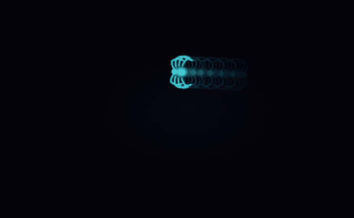
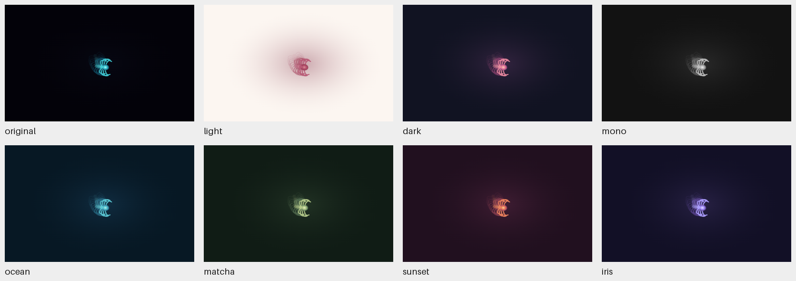

# Glacier trail spider

An icy blue spider turns toward the pointer. Fading cyan outlines trace its eight moving legs across a nearly black field.

| | |
| --- | --- |
| **Category** | [Animations › Cursor effects](../) |
| **Size** | 576 × 355 |
| **Colorways** | original, light, dark, mono, ocean, matcha, sunset, iris |
| **Fonts** | No visible text |
| **Icons** | Original procedural SVG geometry |
| **Animated** | 19.5 seconds, 24 fps |
| **Based on** | [A TikTok by @paulcodes4](https://www.tiktok.com/@paulcodes4/video/7697533502572514581) |

## Every colorway

## Files

- Open [the editable drawing](source/design.html) to watch the loop. Append a colorway such as `#ocean` or use `?t=10#original` to pause it.
- The [exports](exports/) include a full-size still and H.264 loop in every colorway.

## Changing it

The automated path and trailing poses are independently timed. Move the pointer to place the leading spider. Each color token lives in the palette blocks at the top of the HTML. Run `python3 .github/scripts/export_design.py animations/cursor-effects/glacier-trail-spider` to refresh the media.
