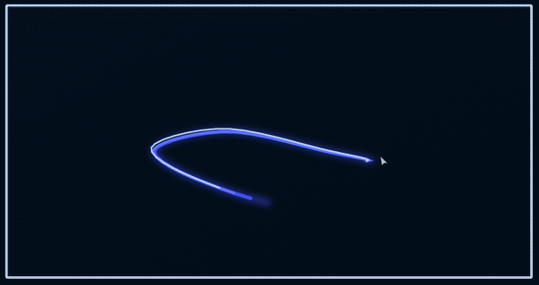
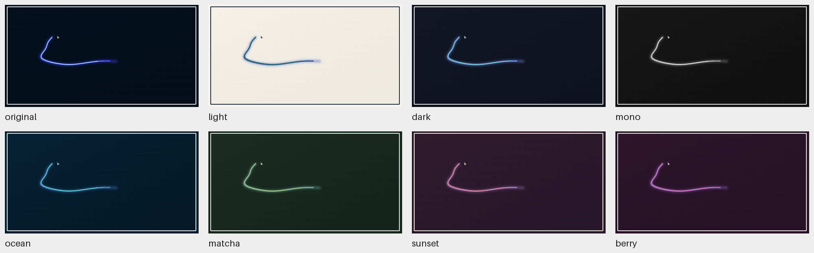

# Indigo filament cursor

A blue filament folds around the moving pointer inside a fine, pale rectangular frame.

| | |
| --- | --- |
| **Category** | [Animations › Cursor effects](../) |
| **Size** | 500 × 264 CSS pixels, 2× export |
| **Colorways** | original, light, dark, mono, ocean, matcha, sunset, berry |
| **Fonts** | None. The artwork contains no lettering. |
| **Artwork** | Original procedural illustration and SVG geometry, drawn for Motherlode |
| **Animated** | Yes, 4.8-second loop |
| **Based on** | [A TikTok by @paulcodes4](https://www.tiktok.com/@paulcodes4/video/7696429124470312212) |

## Every colorway

## Files

- `source/design.html` is the standalone artwork. Its address accepts a palette such as `#matcha` and a preview time such as `?t=1.6#ocean`.
- `exports/` contains each palette’s PNG still and H.264 loop.

## Changing it

Move the pointer within the frame to draw a live trail. The preview follows a closed spline. Its parallel strokes and blur radii control the blue halo. The colorway blocks at the top of the source define the inks and ground. Run `python3 .github/scripts/export_design.py animations/cursor-effects/indigo-filament-cursor` to regenerate the exports.
