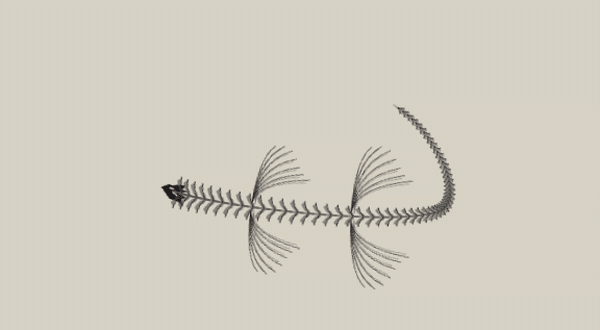
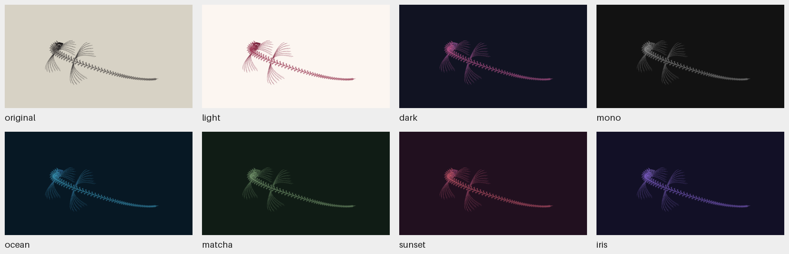

# Inkbone dragon cursor

A long ink dragon follows the pointer on an ivory field. Delicate ribs, paired wing fans and a tapering segmented tail turn through each bend.

| | |
| --- | --- |
| **Category** | [Animations › Cursor effects](../) |
| **Size** | 576 × 317 |
| **Colorways** | original, light, dark, mono, ocean, matcha, sunset, iris |
| **Fonts** | No visible text |
| **Icons** | Original procedural SVG geometry |
| **Animated** | 9 seconds, 24 fps |
| **Based on** | [A TikTok by @paulcodes4](https://www.tiktok.com/@paulcodes4/video/7693821015331179797) |
| **Also shown in** | [A second TikTok by @paulcodes4](https://www.tiktok.com/@paulcodes4/video/7691224525119180038) |

## Every colorway

## Files

- Open [the editable drawing](source/design.html) to watch the loop. Append a colorway such as `#ocean` or use `?t=5.85#original` to pause it.
- The [exports](exports/) include a full-size still and H.264 loop in every colorway.

## Changing it

A shared spline drives the head and successive bones with a small delay. Move the pointer to steer the rig. Each color token lives in the palette blocks at the top of the HTML. Run `python3 .github/scripts/export_design.py animations/cursor-effects/inkbone-dragon-cursor` to refresh the media.
