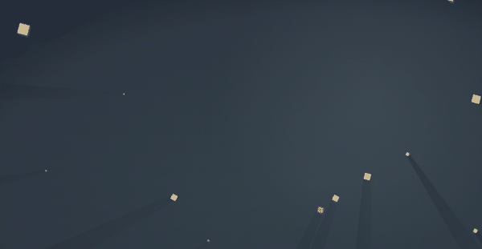
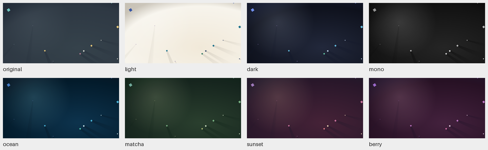

# Pinlight shadow cursor

Small colored squares float over slate and throw long, soft shadows away from a wandering point of light.

| | |
| --- | --- |
| **Category** | [Animations › Cursor effects](../) |
| **Size** | 576 × 299 CSS pixels, 2× export |
| **Colorways** | original, light, dark, mono, ocean, matcha, sunset, berry |
| **Fonts** | None. The artwork contains no lettering. |
| **Artwork** | Original procedural illustration and SVG geometry, drawn for Motherlode |
| **Animated** | Yes, 5.8-second loop |
| **Based on** | [A TikTok by @paulcodes4](https://www.tiktok.com/@paulcodes4/video/7694922476085693716) |

## Every colorway

## Files

- `source/design.html` is the standalone artwork. Its address accepts a palette such as `#matcha` and a preview time such as `?t=2.7#ocean`.
- `exports/` contains each palette’s PNG still and H.264 loop.

## Changing it

Move the pointer to change the shadow origin. Each square has its own projected silhouette, computed from the vector between the square and the light. The colorway blocks at the top of the source define the inks and ground. Run `python3 .github/scripts/export_design.py animations/cursor-effects/pinlight-shadow-cursor` to regenerate the exports.
