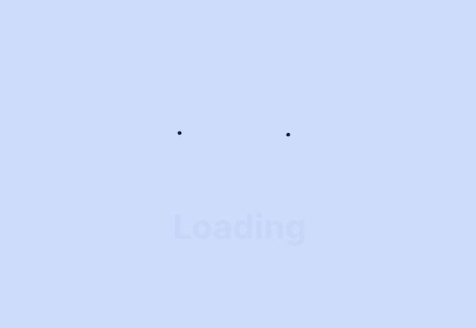
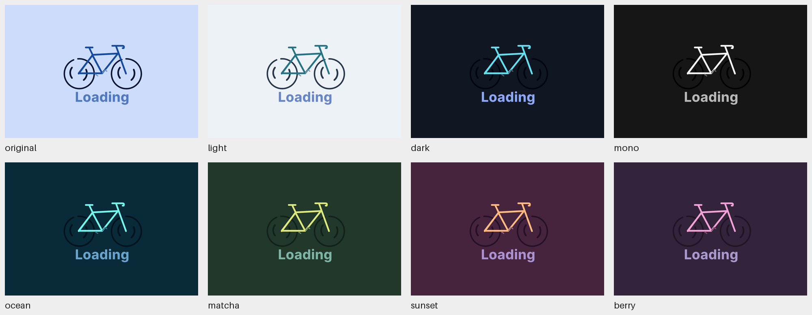

# Blue line bicycle

Black wheel arcs and blue frame strokes draw a bicycle on a pale periwinkle field. The loading label appears beneath it before the lines retreat.

| | |
| --- | --- |
| **Category** | [Animations › Loading animations](../) |
| **Size** | 576 × 397 CSS pixels, exported at 2× |
| **Colorways** | original, light, dark, mono, ocean, matcha, sunset, berry |
| **Fonts** | Inter, bundled under the SIL Open Font License |
| **Artwork** | Original SVG bicycle frame, rotating wheel arcs and timed stroke reveals. |
| **Animated** | Yes, 3-second loop at 24 fps |
| **Based on** | [A TikTok by @paulcodes4](https://www.tiktok.com/@paulcodes4/video/7692089603586641172) |

## Every colorway

## Files

- [Open the standalone design](source/design.html). Select the scene to replay the loop.
- Add `#ocean` to switch palettes or `?t=1.6#ocean` to freeze the animation.
- [Exports](exports/) holds the colorway PNGs and H.264 loops.

## Changing it

Edit the palette variables at the top of [the source](source/design.html), then run `python3 .github/scripts/export_design.py animations/loading-animations/blue-line-bicycle` from the repository root.
