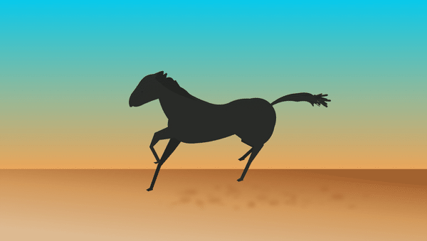
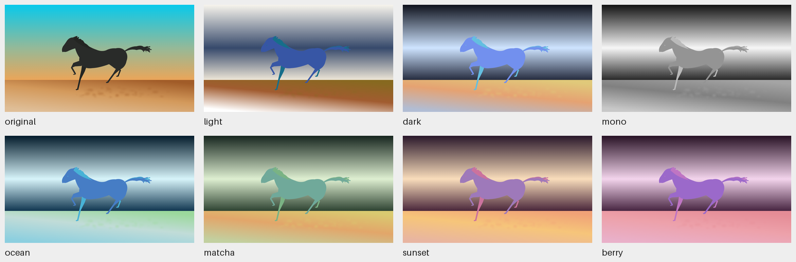

# Dune gallop loader

A dark horse gallops across sunlit sand under a turquoise sky, throwing soft dust behind its hooves.

| | |
| --- | --- |
| **Category** | [Animations › Loading animations](../) |
| **Size** | 576 × 325 CSS pixels, 2× export |
| **Colorways** | original, light, dark, mono, ocean, matcha, sunset, berry |
| **Fonts** | None. The artwork contains no lettering. |
| **Artwork** | Original procedural illustration and SVG geometry, drawn for Motherlode |
| **Animated** | Yes, 3.2-second loop |
| **Based on** | [A TikTok by @paulcodes4](https://www.tiktok.com/@paulcodes4/video/7694181956216474900) |

## Every colorway

## Files

- `source/design.html` is the standalone artwork. Its address accepts a palette such as `#matcha` and a preview time such as `?t=1.65#ocean`.
- `exports/` contains each palette’s PNG still and H.264 loop.

## Changing it

The gallop comes from separately articulated forelegs and hind legs. Eight poses control each limb while the body bobs, tail strands lift and sand drifts behind it. The colorway blocks at the top of the source define the inks and ground. Run `python3 .github/scripts/export_design.py animations/loading-animations/dune-gallop-loader` to regenerate the exports.
