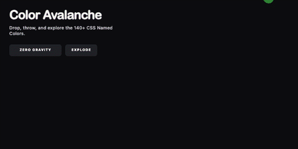
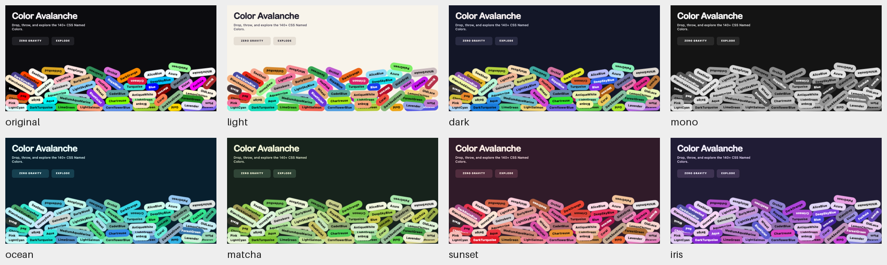

# Color chip avalanche

Capsules labeled with color names tumble across a charcoal surface. Gravity and explosion controls send the colored chips into new formations.

| | |
| --- | --- |
| **Category** | [Animations › Micro Interactions](../) |
| **Size** | 576 × 289 |
| **Colorways** | original, light, dark, mono, ocean, matcha, sunset, iris |
| **Fonts** | System rounded sans-serif and system sans-serif |
| **Icons** | Original SVG capsules |
| **Animated** | 19 seconds, 24 fps |
| **Based on** | [A TikTok by @paulcodes4](https://www.tiktok.com/@paulcodes4/video/7692127239223250197) |

## Every colorway

## Files

- Open [the editable drawing](source/design.html) to watch the loop. Append a colorway such as `#ocean` or use `?t=2.5#original` to pause it.
- The [exports](exports/) include a full-size still and H.264 loop in every colorway.

## Changing it

The opening sequence runs a seeded simulation of 62 rounded capsules. Tap the field to add another of the 148 CSS named colors, drag a capsule to throw it, or use Zero Gravity and Explode to move the pile. Each chip selects a black or white label for its current colorway. Each color token lives in the palette blocks at the top of the HTML. Run `python3 .github/scripts/export_design.py animations/micro-interactions/color-chip-avalanche` to refresh the media.
