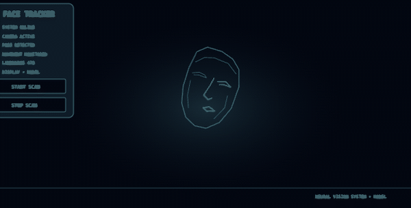
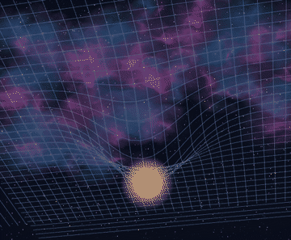
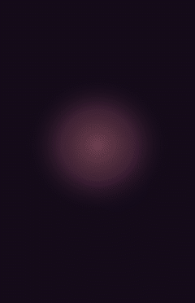
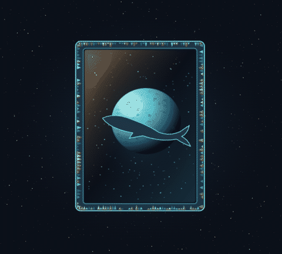

<!-- Generated by .github/scripts/build_catalog.py. Edit that file, not this one. -->
# Motion graphics

Motion graphics.

Part of [Animations](../).

## Designs (13)

<table>
<tr><td align="center" valign="top" width="33%"> <a href="cyan-contour-scan/"><b>Cyan contour scan</b></a> 8 colorways</td><td align="center" valign="top" width="33%"> <a href="gravity-well-atlas/"><b>Gravity well atlas</b></a> 8 colorways</td><td align="center" valign="top" width="33%"> <a href="jade-four-point-filament/"><b>Jade four-point filament</b></a> 8 colorways</td></tr>
<tr><td align="center" valign="top" width="33%"> <a href="moonlace-wheel/"><b>Moonlace wheel</b></a> 8 colorways</td><td align="center" valign="top" width="33%"> <a href="multilingual-heart-type/"><b>Multilingual heart type</b></a> 8 colorways</td><td align="center" valign="top" width="33%"> <a href="orbital-hand-study/"><b>Orbital hand study</b></a> 8 colorways</td></tr>
<tr><td align="center" valign="top" width="33%"> <a href="petalled-heart-astrolabe/"><b>Petalled heart astrolabe</b></a> 8 colorways</td><td align="center" valign="top" width="33%"> <a href="pewter-fractal-wheel/"><b>Pewter fractal wheel</b></a> 8 colorways</td><td align="center" valign="top" width="33%"> <a href="plum-aster-mandala/"><b>Plum aster mandala</b></a> 8 colorways</td></tr>
<tr><td align="center" valign="top" width="33%"> <a href="prism-orbital-mirror/"><b>Prism orbital mirror</b></a> 8 colorways</td><td align="center" valign="top" width="33%"> <a href="rose-nest-contours/"><b>Rose nest contours</b></a> 8 colorways</td><td align="center" valign="top" width="33%"> <a href="rose-twirl-contours/"><b>Rose twirl contours</b></a> 8 colorways</td></tr>
<tr><td align="center" valign="top" width="33%"> <a href="spectrum-pinwheel/"><b>Spectrum pinwheel</b></a> 8 colorways</td></tr>
</table>

Adding one? See [Adding a design](../../README.md#adding-a-design).
