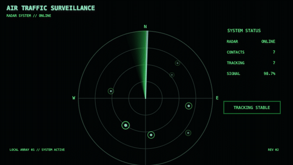
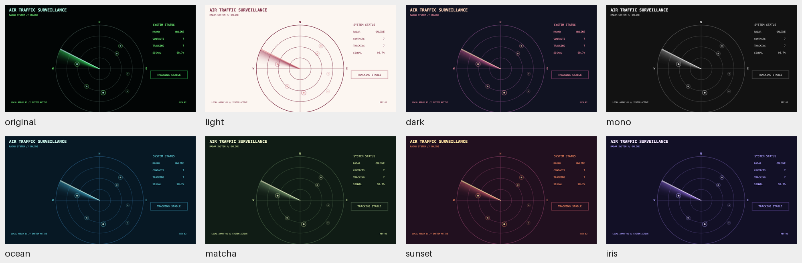

# Air traffic sweep

A rotating green sweep crosses a four-ring air traffic display. Seven points pulse beside the compact system readout.

| | |
| --- | --- |
| **Category** | [Animations › Motion graphics](../) |
| **Size** | 576 × 324 |
| **Colorways** | original, light, dark, mono, ocean, matcha, sunset, iris |
| **Fonts** | System sans-serif and monospace |
| **Icons** | Original procedural SVG geometry |
| **Animated** | 8.3 seconds, 24 fps |
| **Based on** | [A TikTok by @paulcodes4](https://www.tiktok.com/@paulcodes4/video/7698648980296584469) |

## Every colorway

## Files

- Open [the editable drawing](source/design.html) to watch the loop. Append a colorway such as `#ocean` or use `?t=3.4#original` to pause it.
- The [exports](exports/) include a full-size still and H.264 loop in every colorway.

## Changing it

The display uses an illustrative local traffic pattern with separately timed markers and a rotating antenna sweep. Each color token lives in the palette blocks at the top of the HTML. Run `python3 .github/scripts/export_design.py animations/motion-graphics/air-traffic-sweep` to refresh the media.
