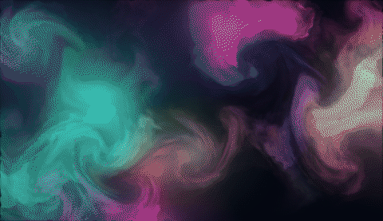
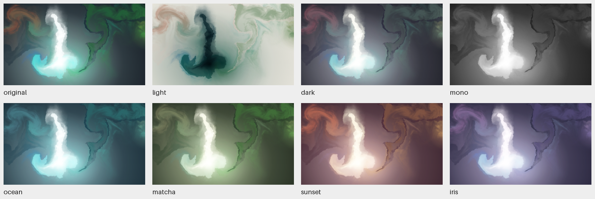

# Chromatic fluid field

Teal, violet and lime pigment spreads and gathers into billowing, irregular clouds across a dark fluid field.

| | |
| --- | --- |
| **Category** | [Animations › Motion graphics](../) |
| **Size** | 576 × 332 |
| **Colorways** | original, light, dark, mono, ocean, matcha, sunset, iris |
| **Fonts** | No visible text |
| **Artwork** | Original SVG pigment paths and procedurally generated displacement and density maps |
| **Animated** | 15 seconds, 24 fps |
| **Based on** | [A TikTok by @paulcodes4](https://www.tiktok.com/@paulcodes4/video/7694241895895141653) |

## Every colorway

## Files

- Open [the editable drawing](source/design.html) to watch the loop. Append a colorway such as `#ocean` or use `?t=10.3#original` to pause it.
- The [exports](exports/) include a full-size still and H.264 loop in every colorway.

## Changing it

Each gesture lays down a tapered pigment band. An independently generated displacement map curls the paint around a field of vortices, and a second layer gives the brightest ink a white core. Move the pointer to deposit a fresh stroke. Each color token lives in the palette blocks at the top of the HTML. Run `python3 .github/scripts/export_design.py animations/motion-graphics/chromatic-fluid-field` to refresh the media.
