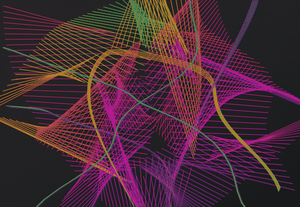
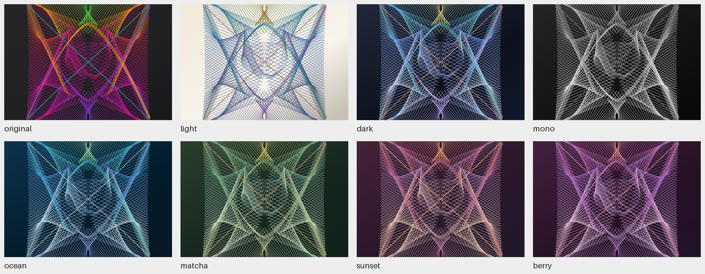

# Chromatic thread loom

Rainbow threads cross a charcoal field as two moving curves draw and unwind a symmetrical mesh.

| | |
| --- | --- |
| **Category** | [Animations › Motion graphics](../) |
| **Size** | 576 × 398 CSS pixels, 2× export |
| **Colorways** | original, light, dark, mono, ocean, matcha, sunset, berry |
| **Fonts** | None. The artwork contains no lettering. |
| **Artwork** | Original procedural illustration and SVG geometry, drawn for Motherlode |
| **Animated** | Yes, 6-second loop |
| **Based on** | [A TikTok by @paulcodes4](https://www.tiktok.com/@paulcodes4/video/7696407614900718900) |

## Every colorway

## Files

- `source/design.html` is the standalone artwork. Its address accepts a palette such as `#matcha` and a preview time such as `?t=0.9#ocean`.
- `exports/` contains each palette’s PNG still and H.264 loop.

## Changing it

The threads span four outer fans, an inner loop and narrow chromatic ribbons. Change the swing function or the fan spacing to reshape the weave. The colorway blocks at the top of the source define the inks and ground. Run `python3 .github/scripts/export_design.py animations/motion-graphics/chromatic-thread-loom` to regenerate the exports.
