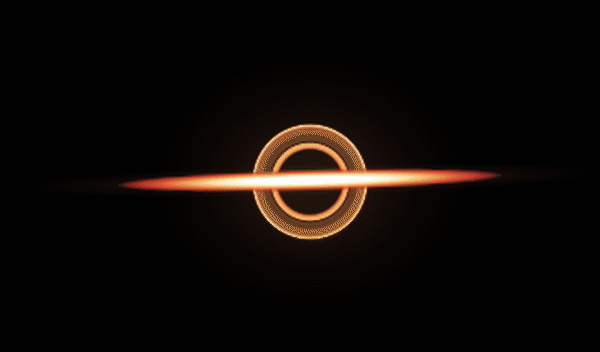
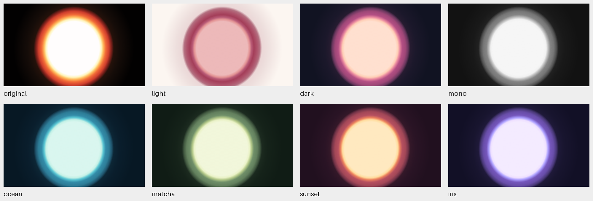

# Gilded event horizon

A narrow line of light cuts through concentric gold rings. As it turns face-on, a white-hot orb fills the rings and its outer edge darkens to red.

| | |
| --- | --- |
| **Category** | [Animations › Motion graphics](../) |
| **Size** | 360 × 211 |
| **Colorways** | original, light, dark, mono, ocean, matcha, sunset, iris |
| **Fonts** | No visible text |
| **Icons** | Original procedural SVG geometry |
| **Animated** | 15.8 seconds, 24 fps |
| **Based on** | [A TikTok by @paulcodes4](https://www.tiktok.com/@paulcodes4/video/7690923183813168390) |

## Every colorway

## Files

- Open [the editable drawing](source/design.html) to watch the loop. Append a colorway such as `#ocean` or use `?t=2.4#original` to pause it.
- The [exports](exports/) include a full-size still and H.264 loop in every colorway.

## Changing it

The opening holds edge-on for one second. The disk presents its face around three seconds, narrows, then pulses with a bright central flare before tipping to the opposite side. The fine rings stay on their own plane. Each color token lives in the palette blocks at the top of the HTML. Run `python3 .github/scripts/export_design.py animations/motion-graphics/gilded-event-horizon` to refresh the media.
