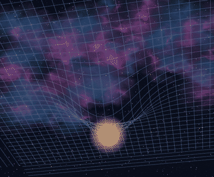
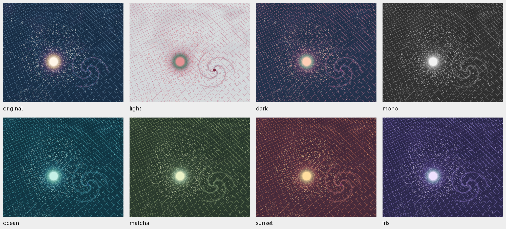

# Gravity well atlas

A blue coordinate net bends through a magenta nebula toward a glowing mass that darkens into an event horizon.

| | |
| --- | --- |
| **Category** | [Animations › Motion graphics](../) |
| **Size** | 576 × 475 |
| **Colorways** | original, light, dark, mono, ocean, matcha, sunset, iris |
| **Fonts** | No visible text |
| **Icons** | Original procedural SVG geometry |
| **Animated** | 15 seconds, 24 fps |
| **Based on** | [A TikTok by @paulcodes4](https://www.tiktok.com/@paulcodes4/video/7706799385920703765) |

## Every colorway

## Files

- Open [the editable drawing](source/design.html) to watch the loop. Append a colorway such as `#ocean` or use `?t=7#original` to pause it.
- The [exports](exports/) include a full-size still and H.264 loop in every colorway.

## Changing it

The mesh is projected from a smooth well. Its camera orbits from an overhead view to a shallow side elevation. The nebula and stars are generated locally. Each color token lives in the palette blocks at the top of the HTML. Run `python3 .github/scripts/export_design.py animations/motion-graphics/gravity-well-atlas` to refresh the media.
