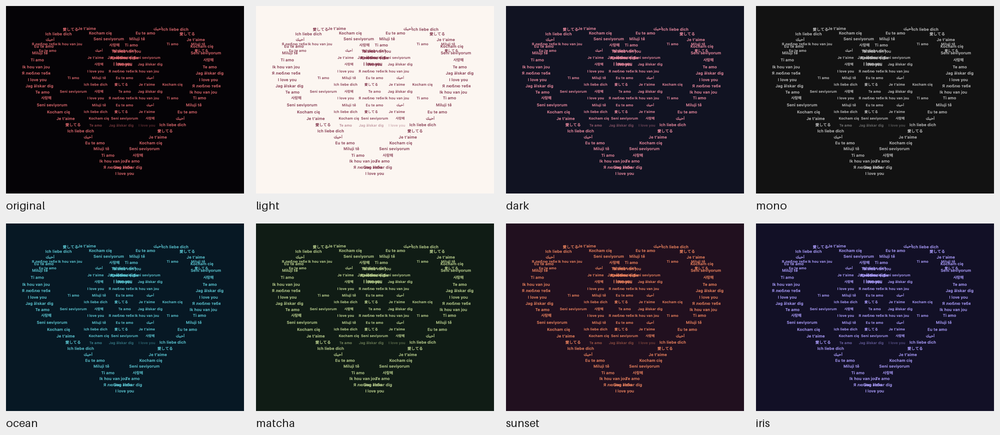

# Multilingual heart type

Short declarations of love in different languages trace a red heart, then fill its center line by line.

| | |
| --- | --- |
| **Category** | [Animations › Motion graphics](../) |
| **Size** | 576 × 454 |
| **Colorways** | original, light, dark, mono, ocean, matcha, sunset, iris |
| **Fonts** | System sans-serif and monospace |
| **Icons** | Original procedural SVG geometry |
| **Animated** | 11 seconds, 24 fps |
| **Based on** | [A TikTok by @paulcodes4](https://www.tiktok.com/@paulcodes4/video/7704206615368551700) |

## Every colorway

## Files

- Open [the editable drawing](source/design.html) to watch the loop. Append a colorway such as `#ocean` or use `?t=8.5#original` to pause it.
- The [exports](exports/) include a full-size still and H.264 loop in every colorway.

## Changing it

Phrases first draw the contour from its cleft around the tip. The interior fills in staggered rows. Each color token lives in the palette blocks at the top of the HTML. Run `python3 .github/scripts/export_design.py animations/motion-graphics/multilingual-heart-type` to refresh the media.
