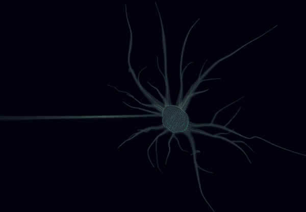
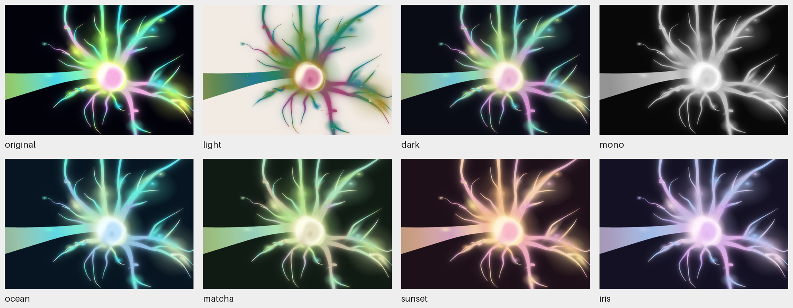

# Prismatic synapse

An electric signal enters from the left and lights up a branching neuron. White, mint and violet pulses race out from the center.

| | |
| --- | --- |
| **Category** | [Animations › Motion graphics](../) |
| **Size** | 576 × 398 |
| **Colorways** | original, light, dark, mono, ocean, matcha, sunset, iris |
| **Fonts** | No visible text |
| **Artwork** | Original variable-width SVG branches, signal paths and halos |
| **Animated** | 10.5 seconds, 24 fps |
| **Based on** | [A TikTok by @paulcodes4](https://www.tiktok.com/@paulcodes4/video/7691361707125394708) |

## Every colorway

## Files

- Open [the editable drawing](source/design.html) to watch the loop. Append a colorway such as `#ocean` or use `?t=8.6#original` to pause it.
- The [exports](exports/) include a full-size still and H.264 loop in every colorway.

## Changing it

A hot input pulse reaches the cell before a radial wave exposes the gradient-filled, tapering branches. Move the pointer to shift the view or press the drawing to send another flash through the arbor. Each color token lives in the palette blocks at the top of the HTML. Run `python3 .github/scripts/export_design.py animations/motion-graphics/prismatic-synapse` to refresh the media.
