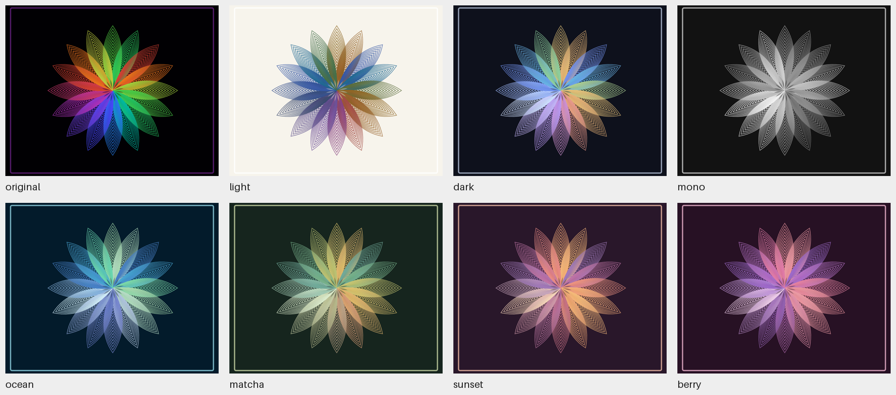

# Rainbow petal spirograph

A sixteen-petal rosette grows from nested rainbow outlines inside a thin violet frame.

| | |
| --- | --- |
| **Category** | [Animations › Motion graphics](../) |
| **Size** | 576 × 461 CSS pixels, 2× export |
| **Colorways** | original, light, dark, mono, ocean, matcha, sunset, berry |
| **Fonts** | None. The artwork contains no lettering. |
| **Artwork** | Original procedural illustration and SVG geometry, drawn for Motherlode |
| **Animated** | Yes, 4.8-second loop |
| **Based on** | [A TikTok by @paulcodes4](https://www.tiktok.com/@paulcodes4/video/7696160368380448020) |

## Every colorway

## Files

- `source/design.html` is the standalone artwork. Its address accepts a palette such as `#matcha` and a preview time such as `?t=4.0#ocean`.
- `exports/` contains each palette’s PNG still and H.264 loop.

## Changing it

Each petal is a graduated family of quadratic curves. The sixteen groups open in angular order and hold together before the loop restarts. The colorway blocks at the top of the source define the inks and ground. Run `python3 .github/scripts/export_design.py animations/motion-graphics/rainbow-petal-spirograph` to regenerate the exports.
