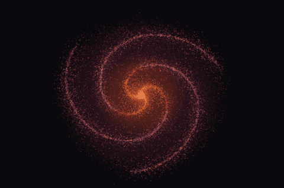
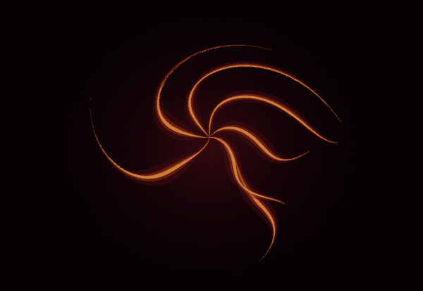
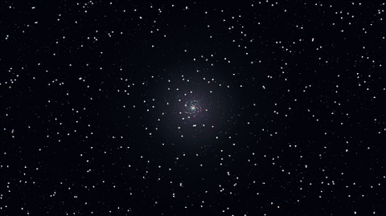

<!-- Generated by .github/scripts/build_catalog.py. Edit that file, not this one. -->
# Particles

Particle effects.

Part of [Animations](../).

## Designs (7)

<table>
<tr><td align="center" valign="top" width="33%"> <a href="carmine-particle-heart/"><b>Carmine particle heart</b></a> 8 colorways</td><td align="center" valign="top" width="33%"> <a href="copper-spiral-galaxy/"><b>Copper spiral galaxy</b></a> 8 colorways</td><td align="center" valign="top" width="33%"> <a href="ember-petal-vortex/"><b>Ember petal vortex</b></a> 8 colorways</td></tr>
<tr><td align="center" valign="top" width="33%"> <a href="prismatic-stellar-arms/"><b>Prismatic stellar arms</b></a> 8 colorways</td><td align="center" valign="top" width="33%"> <a href="ruby-ribbon-heart/"><b>Ruby ribbon heart</b></a> 8 colorways</td><td align="center" valign="top" width="33%"> <a href="starlit-pulse-heart/"><b>Starlit pulse heart</b></a> 8 colorways</td></tr>
<tr><td align="center" valign="top" width="33%"> <a href="ultraviolet-dustwing/"><b>Ultraviolet dustwing</b></a> 8 colorways</td></tr>
</table>

Adding one? See [Adding a design](../../README.md#adding-a-design).
