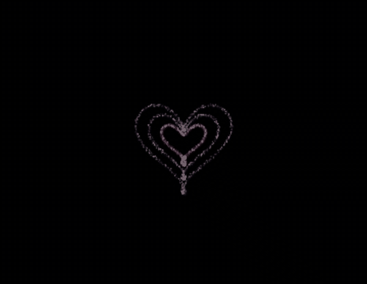
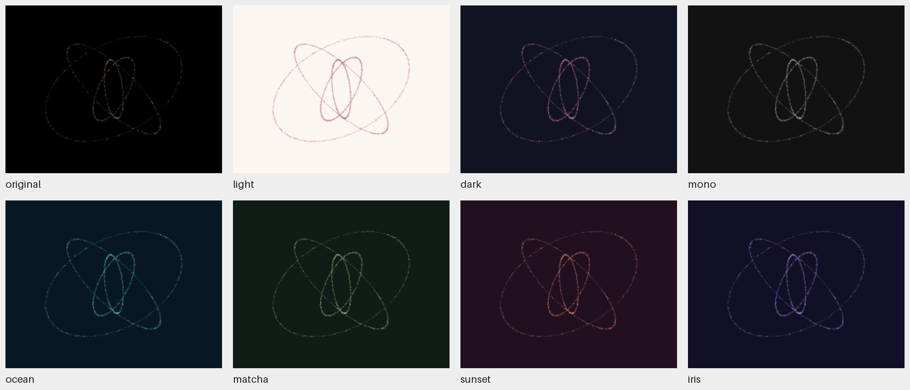

# Afterimage particle forms

Very fine particles appear out of black, moving between nested hearts, slanted orbits, a tall helix and a hazy cloud.

| | |
| --- | --- |
| **Category** | [Animations › Particles](../) |
| **Size** | 360 × 279 |
| **Colorways** | original, light, dark, mono, ocean, matcha, sunset, iris |
| **Fonts** | No visible text |
| **Icons** | Original procedural SVG geometry |
| **Animated** | 10.8 seconds, 24 fps |
| **Based on** | [A TikTok by @paulcodes4](https://www.tiktok.com/@paulcodes4/video/7691585482848767284) |

## Every colorway

## Files

- Open [the editable drawing](source/design.html) to watch the loop. Append a colorway such as `#ocean` or use `?t=4.05#original` to pause it.
- The [exports](exports/) include a full-size still and H.264 loop in every colorway.

## Changing it

Four point distributions alternate, retaining the unusually dim, sparse character of the original. Each color token lives in the palette blocks at the top of the HTML. Run `python3 .github/scripts/export_design.py animations/particles/afterimage-particle-forms` to refresh the media.
