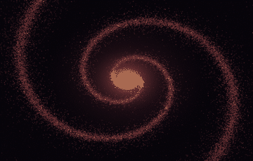
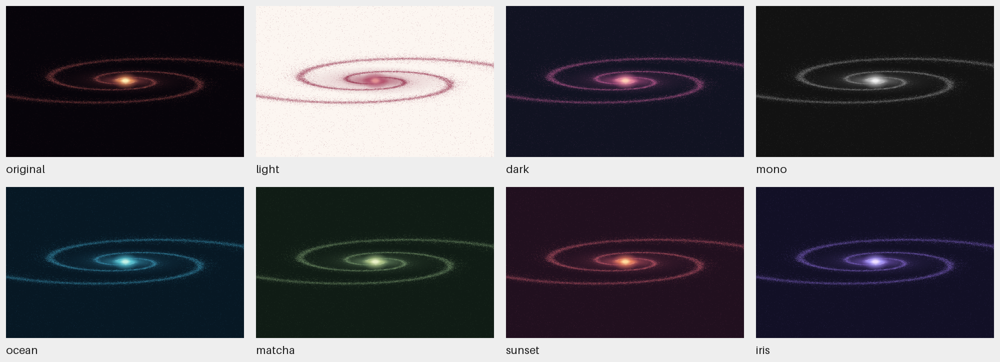

# Amber orbital disk

Two narrow copper arms spiral into a bright amber core while the camera dips to the edge of the galactic disk.

| | |
| --- | --- |
| **Category** | [Animations › Particles](../) |
| **Size** | 576 × 366 |
| **Colorways** | original, light, dark, mono, ocean, matcha, sunset, iris |
| **Fonts** | No visible text |
| **Icons** | Original procedural SVG geometry |
| **Animated** | 13 seconds, 24 fps |
| **Based on** | [A TikTok by @paulcodes4](https://www.tiktok.com/@paulcodes4/video/7697691275037822214) |

## Every colorway

## Files

- Open [the editable drawing](source/design.html) to watch the loop. Append a colorway such as `#ocean` or use `?t=6.3#original` to pause it.
- The [exports](exports/) include a full-size still and H.264 loop in every colorway.

## Changing it

The arms and central bulge use independent particle densities. Camera inclination changes from a high view to a nearly horizontal band and back. Each color token lives in the palette blocks at the top of the HTML. Run `python3 .github/scripts/export_design.py animations/particles/amber-orbital-disk` to refresh the media.
