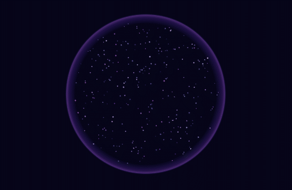
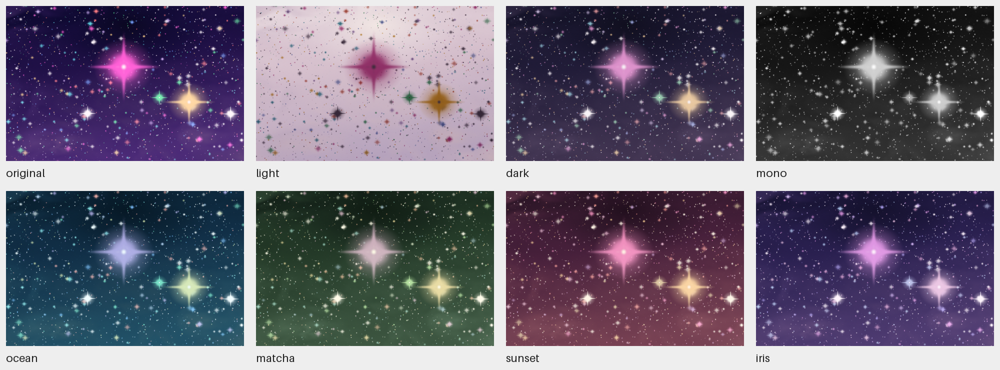

# Amethyst dreamfield

Colored pinpoints scintillate across a purple nebula. Several four-pointed stars bloom into pink, ivory and gold flares.

| | |
| --- | --- |
| **Category** | [Animations › Particles](../) |
| **Size** | 481 × 313 |
| **Colorways** | original, light, dark, mono, ocean, matcha, sunset, iris |
| **Fonts** | No visible text |
| **Artwork** | Original seeded stars and a procedurally textured nebula |
| **Animated** | 7 seconds, 24 fps |
| **Based on** | [A TikTok by @paulcodes4](https://www.tiktok.com/@paulcodes4/video/7700144000300240149) |

## Every colorway

## Files

- Open [the editable drawing](source/design.html) to watch the loop. Append a colorway such as `#ocean` or use `?t=4.2#original` to pause it.
- The [exports](exports/) include a full-size still and H.264 loop in every colorway.

## Changing it

Five depths of seeded stars drift against an original, procedurally textured nebula. Individual crosses flare and fade as the opening sphere dissolves. Move the pointer for parallax, or press the sky to make a nearby star flare. Each color token lives in the palette blocks at the top of the HTML. Run `python3 .github/scripts/export_design.py animations/particles/amethyst-dreamfield` to refresh the media.
