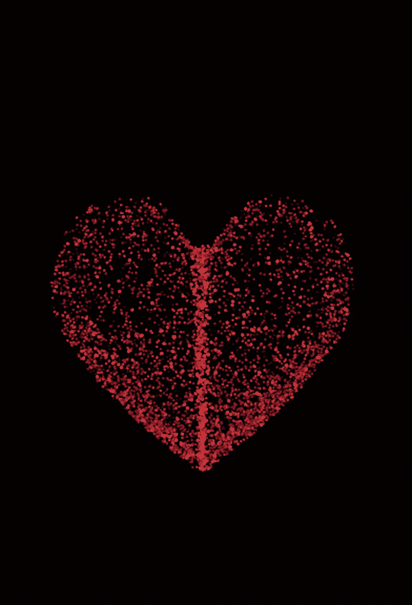
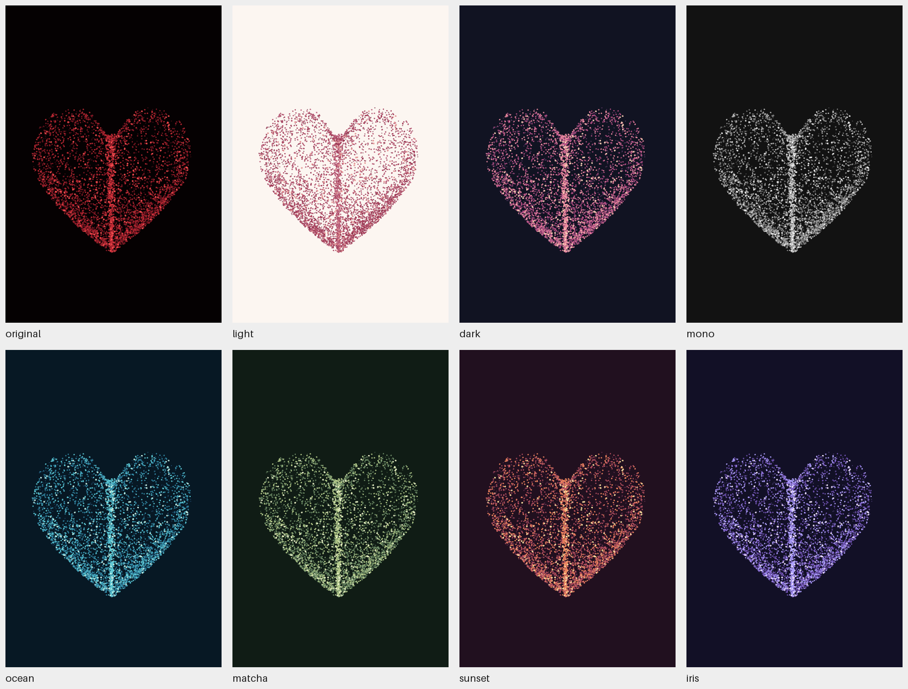

# Carmine particle heart

A cloud of carmine sparks turns from a broad heart to a narrow, glowing profile and back.

| | |
| --- | --- |
| **Category** | [Animations › Particles](../) |
| **Size** | 392 × 576 |
| **Colorways** | original, light, dark, mono, ocean, matcha, sunset, iris |
| **Fonts** | No visible text |
| **Icons** | Original procedural SVG geometry |
| **Animated** | 6 seconds, 24 fps |
| **Based on** | [A TikTok by @paulcodes4](https://www.tiktok.com/@paulcodes4/video/7710141468035386645) |

## Every colorway

## Files

- Open [the editable drawing](source/design.html) to watch the loop. Append a colorway such as `#ocean` or use `?t=0#original` to pause it.
- The [exports](exports/) include a full-size still and H.264 loop in every colorway.

## Changing it

Depth bands project a seeded cloud of points through a complete turn. The editable path groups retain a round grain even when the heart is edge-on. Each color token lives in the palette blocks at the top of the HTML. Run `python3 .github/scripts/export_design.py animations/particles/carmine-particle-heart` to refresh the media.
