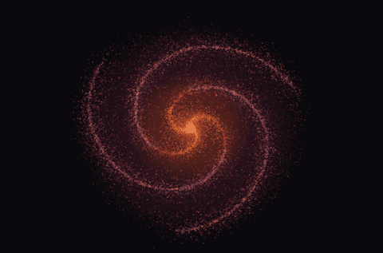
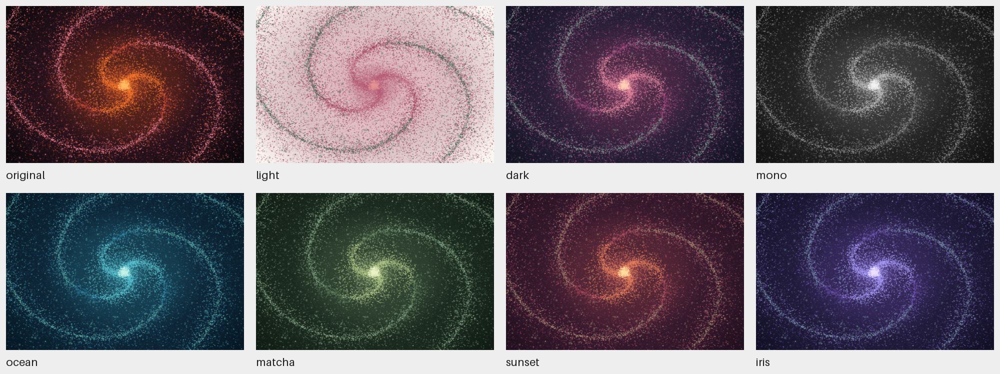

# Copper spiral galaxy

Copper starlight sweeps through curved spiral arms as the view dives toward an incandescent galactic core.

| | |
| --- | --- |
| **Category** | [Animations › Particles](../) |
| **Size** | 488 × 322 |
| **Colorways** | original, light, dark, mono, ocean, matcha, sunset, iris |
| **Fonts** | No visible text |
| **Icons** | Original procedural SVG geometry |
| **Animated** | 8 seconds, 24 fps |
| **Based on** | [A TikTok by @paulcodes4](https://www.tiktok.com/@paulcodes4/video/7707726077682044180) |

## Every colorway

## Files

- Open [the editable drawing](source/design.html) to watch the loop. Append a colorway such as `#ocean` or use `?t=1.1#original` to pause it.
- The [exports](exports/) include a full-size still and H.264 loop in every colorway.

## Changing it

A seeded particle field traces three copper arms with pink filaments and a compact amber core. The camera moves into the disk, holds among the stars and lowers toward the rim. Three foreground layers move across the spiral at different speeds. Each color token lives in the palette blocks at the top of the HTML. Run `python3 .github/scripts/export_design.py animations/particles/copper-spiral-galaxy` to refresh the media.
