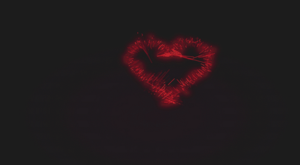
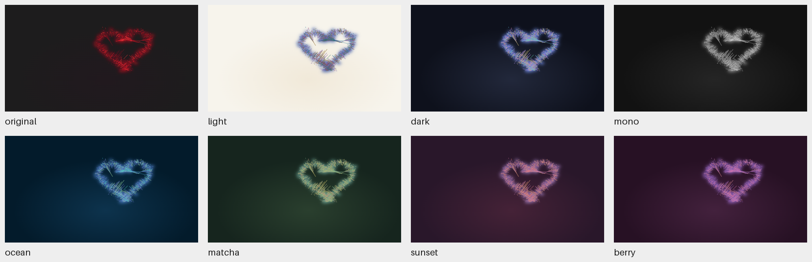

# Crimson nebula heart

A glowing crimson heart made of scattered filaments expands and collapses as it drifts through smoky charcoal.

| | |
| --- | --- |
| **Category** | [Animations › Particles](../) |
| **Size** | 576 × 318 CSS pixels, 2× export |
| **Colorways** | original, light, dark, mono, ocean, matcha, sunset, berry |
| **Fonts** | None. The artwork contains no lettering. |
| **Artwork** | Original procedural illustration and SVG geometry, drawn for Motherlode |
| **Animated** | Yes, 5.6-second loop |
| **Based on** | [A TikTok by @paulcodes4](https://www.tiktok.com/@paulcodes4/video/7693447093486406932) |

## Every colorway

## Files

- `source/design.html` is the standalone artwork. Its address accepts a palette such as `#matcha` and a preview time such as `?t=3.1#ocean`.
- `exports/` contains each palette’s PNG still and H.264 loop.

## Changing it

The core uses a parametric heart. Tangent and normal directions generate bright fissures and streaks, while a softly blurred layer gives the red cloud its volume. The colorway blocks at the top of the source define the inks and ground. Run `python3 .github/scripts/export_design.py animations/particles/crimson-nebula-heart` to regenerate the exports.
